# Awesome Qwen 4 Max

English · [简体中文](README.zh-CN.md)

[](https://awesome.re) [](#contents) [](docs/prompts.md) [](https://github.com/sandbase-lab/awesome-qwen4-max/actions/workflows/sync.yml) [](https://www.sandbase.ai/model/alibaba/qwen4-max?utm_source=github&utm_medium=readme&utm_campaign=awesome-qwen4-max)

[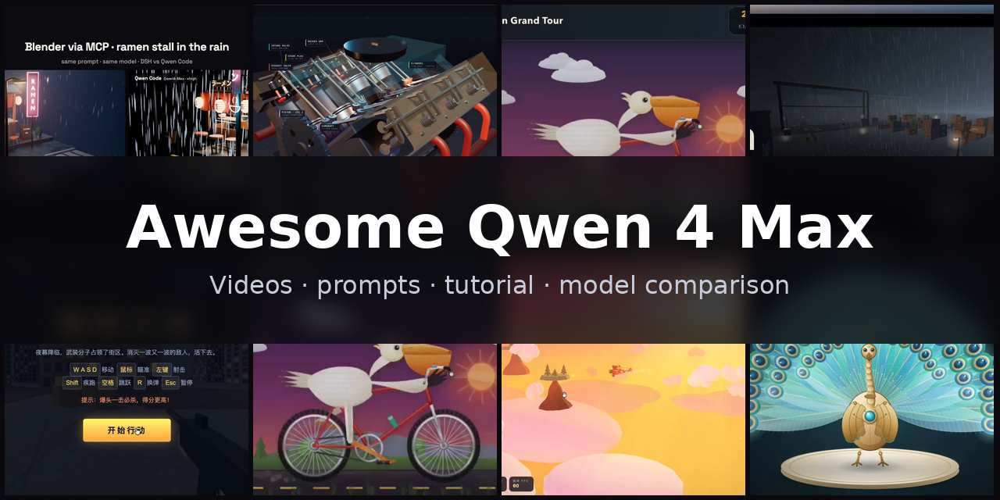](https://www.sandbase.ai/lab/ai-videos/qwen4-max?utm_source=github&utm_medium=readme&utm_campaign=awesome-qwen4-max&utm_content=banner)

A curated list of **Qwen 4 Max examples**: videos, prompts and demos made with Qwen4-Max, Alibaba's Qwen 4 Max model, announced on November 11, 2026 and tested by creators in preview. Three.js and WebGL 3D scenes, SVG and canvas animation, motion graphics, product UI and playable browser games, most of them written as one self-contained HTML page from a prompt, each one credited to its creator and linked to the original post.

**78 videos** from **56 creators** · **20** with the creator's prompt · synced daily from [SandBase Lab](https://www.sandbase.ai/lab/ai-videos/qwen4-max?utm_source=github&utm_medium=readme&utm_campaign=awesome-qwen4-max&utm_content=stats)

## Start here

| I want to… | Go to |
|---|---|
| Watch the videos | [Browse by category](#contents) below, or [play them full-size on SandBase Lab](https://www.sandbase.ai/lab/ai-videos/qwen4-max?utm_source=github&utm_medium=readme&utm_campaign=awesome-qwen4-max&utm_content=quickstart) |
| Copy a prompt | [Prompt index](docs/prompts.md): every video that comes with its prompt |
| Write your own prompt | [Prompt guide](docs/prompt-guide.md): 7 patterns and a fill-in template |
| Make a video | [Tutorial](docs/tutorial.md): prompt → HTML → MP4, with the API, the CLI and a recording script |
| Pick a model | [Qwen 4 Max vs. Claude Opus 5.5, Claude Sonnet 5.5 and Gemini 4 Hydrogen](docs/model-comparison.md) |
| Try it now | [Run Qwen 4 Max in the Lab arena](https://www.sandbase.ai/arena/text?models=alibaba%2Fqwen4-max&utm_source=github&utm_medium=readme&utm_campaign=awesome-qwen4-max&utm_content=quickstart), next to other models |

<a id="contents"></a>

## Contents

- [Featured](#featured) (8)
- [3D scenes](#3d-scene) (24)
- [Motion graphics](#motion-graphics) (13)
- [Games](#game) (5)
- [Product UI](#ui-demo) (1)
- [Kinetic type](#kinetic-type) (1)
- [Explainers](#explainer) (1)
- [Tests & comparisons](#comparison) (33)
- [Recreate a video with Qwen 4 Max](#recreate)
- [FAQ](#faq)
- [Suggest a video](#contribute)

Click a preview to play the video. Click a title for the post, the prompt and **Recreate** on SandBase Lab. **@handle** links to the creator's post on X.

<a id="featured"></a>

## Featured

<table>
<tr><td width="33%" valign="top"><a href="https://www.sandbase.ai/lab/media/x/qwen4-max/2122153465925308590/video.mp4">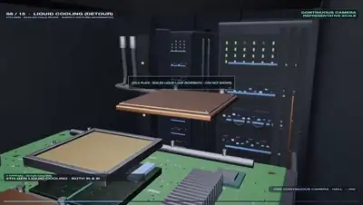</a><br><a href="https://www.sandbase.ai/lab/ai-videos/qwen4-max/2122153465925308590?utm_source=github&utm_medium=readme&utm_campaign=awesome-qwen4-max&utm_content=card"><b>Chip benchmarks test animation with Qwen 4 Max</b></a><br><sub><a href="https://x.com/SPAC89/status/2122153465925308590">@SPAC89</a> · 0:25</sub></td><td width="33%" valign="top"><a href="https://www.sandbase.ai/lab/media/x/qwen4-max/2120666965060559213/video.mp4">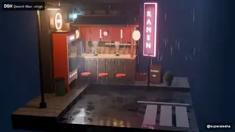</a><br><a href="https://www.sandbase.ai/lab/ai-videos/qwen4-max/2120666965060559213?utm_source=github&utm_medium=readme&utm_campaign=awesome-qwen4-max&utm_content=card"><b>Ramen stall procedural diorama in Blender</b></a><br><sub><a href="https://x.com/superalesha/status/2120666965060559213">@superalesha</a> · 0:37 · <a href="https://www.sandbase.ai/lab/ai-videos/qwen4-max/2120666965060559213?utm_source=github&utm_medium=readme&utm_campaign=awesome-qwen4-max&utm_content=card">prompt</a></sub></td><td width="33%" valign="top"><a href="https://www.sandbase.ai/lab/media/x/qwen4-max/2120598391738818728/video.mp4">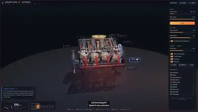</a><br><a href="https://www.sandbase.ai/lab/ai-videos/qwen4-max/2120598391738818728?utm_source=github&utm_medium=readme&utm_campaign=awesome-qwen4-max&utm_content=card"><b>V8 engine cutaway simulation in Three.js</b></a><br><sub><a href="https://x.com/ItsmeAjayKV/status/2120598391738818728">@ItsmeAjayKV</a> · 1:58</sub></td></tr>
<tr><td width="33%" valign="top"><a href="https://www.sandbase.ai/lab/media/x/qwen4-max/2120345166997324170/video.mp4">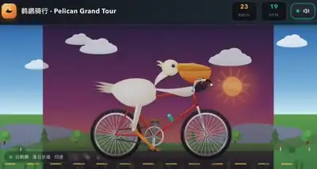</a><br><a href="https://www.sandbase.ai/lab/ai-videos/qwen4-max/2120345166997324170?utm_source=github&utm_medium=readme&utm_campaign=awesome-qwen4-max&utm_content=card"><b>Animated SVG of a pelican riding a bike</b></a><br><sub><a href="https://x.com/leo114119/status/2120345166997324170">@leo114119</a> · 0:33</sub></td><td width="33%" valign="top"><a href="https://www.sandbase.ai/lab/media/x/qwen4-max/2120414419230605560/video.mp4"></a><br><a href="https://www.sandbase.ai/lab/ai-videos/qwen4-max/2120414419230605560?utm_source=github&utm_medium=readme&utm_campaign=awesome-qwen4-max&utm_content=card"><b>An animated SVG of a pelican riding a bicycle</b></a><br><sub><a href="https://x.com/xiangxiang103/status/2120414419230605560">@xiangxiang103</a> · 2:01 · <a href="https://www.sandbase.ai/lab/ai-videos/qwen4-max/2120414419230605560?utm_source=github&utm_medium=readme&utm_campaign=awesome-qwen4-max&utm_content=card">prompt</a></sub></td><td width="33%" valign="top"><a href="https://www.sandbase.ai/lab/media/x/qwen4-max/2120492162148384834/video.mp4">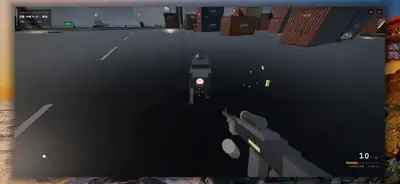</a><br><a href="https://www.sandbase.ai/lab/ai-videos/qwen4-max/2120492162148384834?utm_source=github&utm_medium=readme&utm_campaign=awesome-qwen4-max&utm_content=card"><b>Replicating a Game in a Single HTML File</b></a><br><sub><a href="https://x.com/LufzzLiz/status/2120492162148384834">@LufzzLiz</a> · 1:13</sub></td></tr>
<tr><td width="33%" valign="top"><a href="https://www.sandbase.ai/lab/media/x/qwen4-max/2122179851901968466/video.mp4">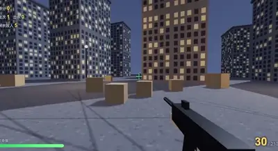</a><br><a href="https://www.sandbase.ai/lab/ai-videos/qwen4-max/2122179851901968466?utm_source=github&utm_medium=readme&utm_campaign=awesome-qwen4-max&utm_content=card"><b>A single file 3D shooting game</b></a><br><sub><a href="https://x.com/niandwo/status/2122179851901968466">@niandwo</a> · 0:24 · <a href="https://www.sandbase.ai/lab/ai-videos/qwen4-max/2122179851901968466?utm_source=github&utm_medium=readme&utm_campaign=awesome-qwen4-max&utm_content=card">prompt</a></sub></td><td width="33%" valign="top"><a href="https://www.sandbase.ai/lab/media/x/qwen4-max/2122233643188068773/video.mp4">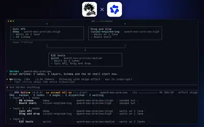</a><br><a href="https://www.sandbase.ai/lab/ai-videos/qwen4-max/2122233643188068773?utm_source=github&utm_medium=readme&utm_campaign=awesome-qwen4-max&utm_content=card"><b>Multi-agent workflow simulation using Qwen4-Max</b></a><br><sub><a href="https://x.com/rlaope/status/2122233643188068773">@rlaope</a> · 0:15</sub></td></tr>
</table>

<a id="3d-scene"></a>

## 3D scenes

<table>
<tr><td width="33%" valign="top"><a href="https://www.sandbase.ai/lab/media/x/qwen4-max/2120344625542213642/video.mp4">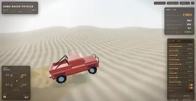</a><br><a href="https://www.sandbase.ai/lab/ai-videos/qwen4-max/2120344625542213642?utm_source=github&utm_medium=readme&utm_campaign=awesome-qwen4-max&utm_content=card"><b>One-shot generation test using Qwen 4 Max</b></a><br><sub><a href="https://x.com/hollaluccaxo/status/2120344625542213642">@hollaluccaxo</a> · 0:46</sub></td><td width="33%" valign="top"><a href="https://www.sandbase.ai/lab/media/x/qwen4-max/2120371909624033439/video.mp4">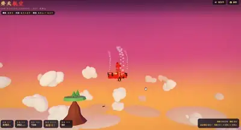</a><br><a href="https://www.sandbase.ai/lab/ai-videos/qwen4-max/2120371909624033439?utm_source=github&utm_medium=readme&utm_campaign=awesome-qwen4-max&utm_content=card"><b>Sun Wukong flying an airplane in 3D</b></a><br><sub><a href="https://x.com/leo114119/status/2120371909624033439">@leo114119</a> · 1:26</sub></td><td width="33%" valign="top"><a href="https://www.sandbase.ai/lab/media/x/qwen4-max/2120421925407355012/video.mp4">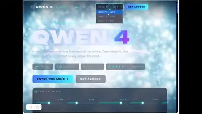</a><br><a href="https://www.sandbase.ai/lab/ai-videos/qwen4-max/2120421925407355012?utm_source=github&utm_medium=readme&utm_campaign=awesome-qwen4-max&utm_content=card"><b>Animated 3D website in a single HTML file</b></a><br><sub><a href="https://x.com/IshanJX/status/2120421925407355012">@IshanJX</a> · 0:57 · <a href="https://www.sandbase.ai/lab/ai-videos/qwen4-max/2120421925407355012?utm_source=github&utm_medium=readme&utm_campaign=awesome-qwen4-max&utm_content=card">prompt</a></sub></td></tr>
<tr><td width="33%" valign="top"><a href="https://www.sandbase.ai/lab/media/x/qwen4-max/2120441039022678027/video.mp4">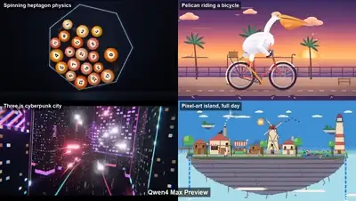</a><br><a href="https://www.sandbase.ai/lab/ai-videos/qwen4-max/2120441039022678027?utm_source=github&utm_medium=readme&utm_campaign=awesome-qwen4-max&utm_content=card"><b>Creative coding benchmarks generated by Qwen4 Max</b></a><br><sub><a href="https://x.com/pradeepXkapoor/status/2120441039022678027">@pradeepXkapoor</a> · 0:20</sub></td><td width="33%" valign="top"><a href="https://www.sandbase.ai/lab/media/x/qwen4-max/2120448740012265621/video.mp4">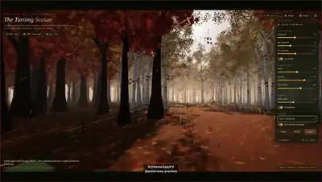</a><br><a href="https://www.sandbase.ai/lab/ai-videos/qwen4-max/2120448740012265621?utm_source=github&utm_medium=readme&utm_campaign=awesome-qwen4-max&utm_content=card"><b>Maple and birch forest at peak autumn</b></a><br><sub><a href="https://x.com/ItsmeAjayKV/status/2120448740012265621">@ItsmeAjayKV</a> · 1:36 · <a href="https://www.sandbase.ai/lab/ai-videos/qwen4-max/2120448740012265621?utm_source=github&utm_medium=readme&utm_campaign=awesome-qwen4-max&utm_content=card">prompt</a></sub></td><td width="33%" valign="top"><a href="https://www.sandbase.ai/lab/media/x/qwen4-max/2120453038624440608/video.mp4">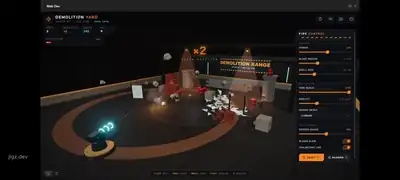</a><br><a href="https://www.sandbase.ai/lab/ai-videos/qwen4-max/2120453038624440608?utm_source=github&utm_medium=readme&utm_campaign=awesome-qwen4-max&utm_content=card"><b>3D destruction playground in Three.js</b></a><br><sub><a href="https://x.com/debugsenpai/status/2120453038624440608">@debugsenpai</a> · 0:31</sub></td></tr>
</table>

<details>
<summary><b>Show all 24</b></summary>

<table>
<tr><td width="33%" valign="top"><a href="https://www.sandbase.ai/lab/media/x/qwen4-max/2120578444518166707/video.mp4">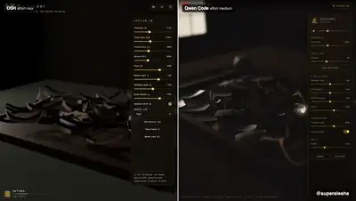</a><br><a href="https://www.sandbase.ai/lab/ai-videos/qwen4-max/2120578444518166707?utm_source=github&utm_medium=readme&utm_campaign=awesome-qwen4-max&utm_content=card"><b>Kintsugi glowing bowl generated in code</b></a><br><sub><a href="https://x.com/superalesha/status/2120578444518166707">@superalesha</a> · 0:22</sub></td><td width="33%" valign="top"><a href="https://www.sandbase.ai/lab/media/x/qwen4-max/2120598391738818728/video.mp4"></a><br><a href="https://www.sandbase.ai/lab/ai-videos/qwen4-max/2120598391738818728?utm_source=github&utm_medium=readme&utm_campaign=awesome-qwen4-max&utm_content=card"><b>V8 engine cutaway simulation in Three.js</b></a><br><sub><a href="https://x.com/ItsmeAjayKV/status/2120598391738818728">@ItsmeAjayKV</a> · 1:58</sub></td><td width="33%" valign="top"><a href="https://www.sandbase.ai/lab/media/x/qwen4-max/2120666965060559213/video.mp4"></a><br><a href="https://www.sandbase.ai/lab/ai-videos/qwen4-max/2120666965060559213?utm_source=github&utm_medium=readme&utm_campaign=awesome-qwen4-max&utm_content=card"><b>Ramen stall procedural diorama in Blender</b></a><br><sub><a href="https://x.com/superalesha/status/2120666965060559213">@superalesha</a> · 0:37 · <a href="https://www.sandbase.ai/lab/ai-videos/qwen4-max/2120666965060559213?utm_source=github&utm_medium=readme&utm_campaign=awesome-qwen4-max&utm_content=card">prompt</a></sub></td></tr>
<tr><td width="33%" valign="top"><a href="https://www.sandbase.ai/lab/media/x/qwen4-max/2121086418566943080/video.mp4">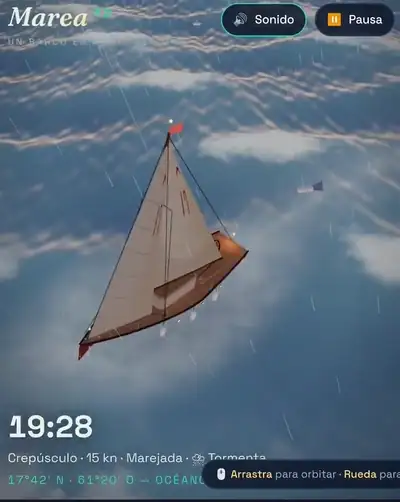</a><br><a href="https://www.sandbase.ai/lab/ai-videos/qwen4-max/2121086418566943080?utm_source=github&utm_medium=readme&utm_campaign=awesome-qwen4-max&utm_content=card"><b>3D ship simulating ocean and air currents</b></a><br><sub><a href="https://x.com/FluoxWordl/status/2121086418566943080">@FluoxWordl</a> · 0:25 · <a href="https://www.sandbase.ai/lab/ai-videos/qwen4-max/2121086418566943080?utm_source=github&utm_medium=readme&utm_campaign=awesome-qwen4-max&utm_content=card">prompt</a></sub></td><td width="33%" valign="top"><a href="https://www.sandbase.ai/lab/media/x/qwen4-max/2121939161812697367/video.mp4">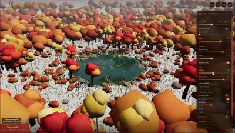</a><br><a href="https://www.sandbase.ai/lab/ai-videos/qwen4-max/2121939161812697367?utm_source=github&utm_medium=readme&utm_campaign=awesome-qwen4-max&utm_content=card"><b>Pond in an autumn forest with koi fish</b></a><br><sub><a href="https://x.com/ItsmeAjayKV/status/2121939161812697367">@ItsmeAjayKV</a> · 1:38</sub></td><td width="33%" valign="top"><a href="https://www.sandbase.ai/lab/media/x/qwen4-max/2121996471830818966/video.mp4">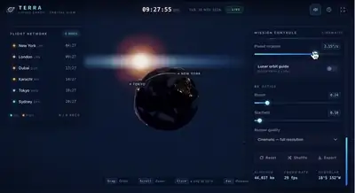</a><br><a href="https://www.sandbase.ai/lab/ai-videos/qwen4-max/2121996471830818966?utm_source=github&utm_medium=readme&utm_campaign=awesome-qwen4-max&utm_content=card"><b>A 3D Earth spinning in space</b></a><br><sub><a href="https://x.com/iamfakhrealam/status/2121996471830818966">@iamfakhrealam</a> · 0:17</sub></td></tr>
<tr><td width="33%" valign="top"><a href="https://www.sandbase.ai/lab/media/x/qwen4-max/2122179688319930761/video.mp4">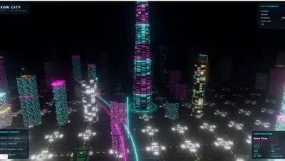</a><br><a href="https://www.sandbase.ai/lab/ai-videos/qwen4-max/2122179688319930761?utm_source=github&utm_medium=readme&utm_campaign=awesome-qwen4-max&utm_content=card"><b>Cyberpunk city built with Three.js</b></a><br><sub><a href="https://x.com/NFT_Chen/status/2122179688319930761">@NFT_Chen</a> · 1:07</sub></td><td width="33%" valign="top"><a href="https://www.sandbase.ai/lab/media/x/qwen4-max/2122198718829236635/video.mp4">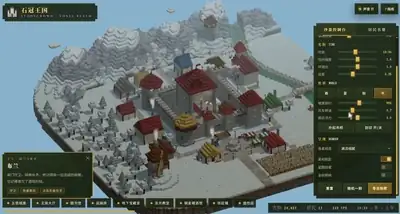</a><br><a href="https://www.sandbase.ai/lab/ai-videos/qwen4-max/2122198718829236635?utm_source=github&utm_medium=readme&utm_campaign=awesome-qwen4-max&utm_content=card"><b>Three.js voxel medieval kingdom sandbox</b></a><br><sub><a href="https://x.com/dragono64v/status/2122198718829236635">@dragono64v</a> · 0:48</sub></td><td width="33%" valign="top"><a href="https://www.sandbase.ai/lab/media/x/qwen4-max/2122206601217966418/video.mp4"></a><br><a href="https://www.sandbase.ai/lab/ai-videos/qwen4-max/2122206601217966418?utm_source=github&utm_medium=readme&utm_campaign=awesome-qwen4-max&utm_content=card"><b>Voxel style Eiffel Tower created with Qwen 4 Max</b></a><br><sub><a href="https://x.com/nawariokra/status/2122206601217966418">@nawariokra</a> · 1:26 · <a href="https://www.sandbase.ai/lab/ai-videos/qwen4-max/2122206601217966418?utm_source=github&utm_medium=readme&utm_campaign=awesome-qwen4-max&utm_content=card">prompt</a></sub></td></tr>
<tr><td width="33%" valign="top"><a href="https://www.sandbase.ai/lab/media/x/qwen4-max/2122206740544647474/video.mp4">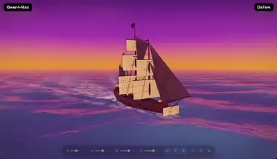</a><br><a href="https://www.sandbase.ai/lab/ai-videos/qwen4-max/2122206740544647474?utm_source=github&utm_medium=readme&utm_campaign=awesome-qwen4-max&utm_content=card"><b>A simple 3D scene control panel</b></a><br><sub><a href="https://x.com/Da7_Tech/status/2122206740544647474">@Da7_Tech</a> · 0:17</sub></td><td width="33%" valign="top"><a href="https://www.sandbase.ai/lab/media/x/qwen4-max/2122207033885933633/video.mp4">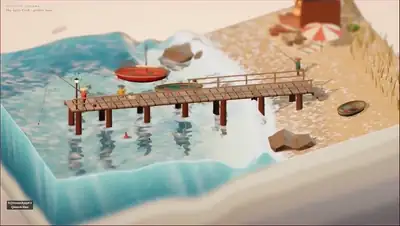</a><br><a href="https://www.sandbase.ai/lab/ai-videos/qwen4-max/2122207033885933633?utm_source=github&utm_medium=readme&utm_campaign=awesome-qwen4-max&utm_content=card"><b>A 3D world generated in one shot</b></a><br><sub><a href="https://x.com/ItsmeAjayKV/status/2122207033885933633">@ItsmeAjayKV</a> · 0:47</sub></td><td width="33%" valign="top"><a href="https://www.sandbase.ai/lab/media/x/qwen4-max/2122232702892232866/video.mp4">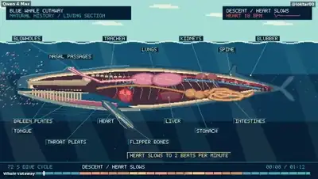</a><br><a href="https://www.sandbase.ai/lab/ai-videos/qwen4-max/2122232702892232866?utm_source=github&utm_medium=readme&utm_campaign=awesome-qwen4-max&utm_content=card"><b>A collection of Qwen 4 Max demos</b></a><br><sub><a href="https://x.com/loktar00/status/2122232702892232866">@loktar00</a> · 1:06</sub></td></tr>
<tr><td width="33%" valign="top"><a href="https://www.sandbase.ai/lab/media/x/qwen4-max/2122237833364811837/video.mp4">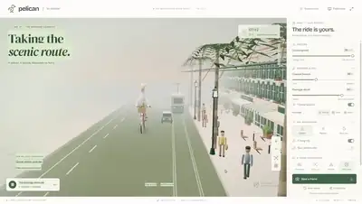</a><br><a href="https://www.sandbase.ai/lab/ai-videos/qwen4-max/2122237833364811837?utm_source=github&utm_medium=readme&utm_campaign=awesome-qwen4-max&utm_content=card"><b>Animated pelican riding a bicycle</b></a><br><sub><a href="https://x.com/doe_naps/status/2122237833364811837">@doe_naps</a> · 0:59</sub></td><td width="33%" valign="top"><a href="https://www.sandbase.ai/lab/media/x/qwen4-max/2122260716245651532/video.mp4">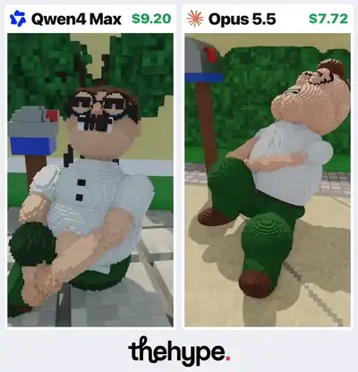</a><br><a href="https://www.sandbase.ai/lab/ai-videos/qwen4-max/2122260716245651532?utm_source=github&utm_medium=readme&utm_campaign=awesome-qwen4-max&utm_content=card"><b>Voxel style Peter Griffin knee meme</b></a><br><sub><a href="https://x.com/thehypedotnews/status/2122260716245651532">@thehypedotnews</a> · 0:13</sub></td><td width="33%" valign="top"><a href="https://www.sandbase.ai/lab/media/x/qwen4-max/2122264972889563391/video.mp4">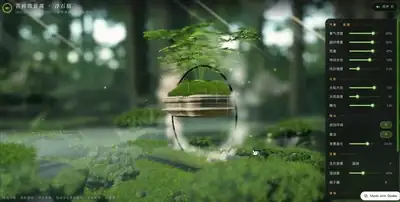</a><br><a href="https://www.sandbase.ai/lab/ai-videos/qwen4-max/2122264972889563391?utm_source=github&utm_medium=readme&utm_campaign=awesome-qwen4-max&utm_content=card"><b>Interactive 3D moss forest landscape micro-scene</b></a><br><sub><a href="https://x.com/tanglele0318/status/2122264972889563391">@tanglele0318</a> · 0:37</sub></td></tr>
<tr><td width="33%" valign="top"><a href="https://www.sandbase.ai/lab/media/x/kimi-k3-1/2122284797301084386/video.mp4">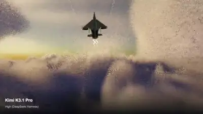</a><br><a href="https://www.sandbase.ai/lab/ai-videos/qwen4-max/2122284797301084386?utm_source=github&utm_medium=readme&utm_campaign=awesome-qwen4-max&utm_content=card"><b>Fighter jet flying through volumetric clouds</b></a><br><sub><a href="https://x.com/superalesha/status/2122284797301084386">@superalesha</a> · 1:00</sub></td><td width="33%" valign="top"><a href="https://www.sandbase.ai/lab/media/x/qwen4-max/2122322999747735867/video.mp4">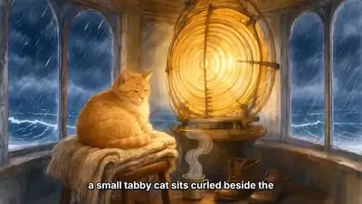</a><br><a href="https://www.sandbase.ai/lab/ai-videos/qwen4-max/2122322999747735867?utm_source=github&utm_medium=readme&utm_campaign=awesome-qwen4-max&utm_content=card"><b>Qwen4-Max generated 3D video work</b></a><br><sub><a href="https://x.com/QwenAIFans/status/2122322999747735867">@QwenAIFans</a> · 0:15</sub></td><td width="33%" valign="top"><a href="https://www.sandbase.ai/lab/media/x/gemini-4-hydrogen/2122349082723176738/video.mp4">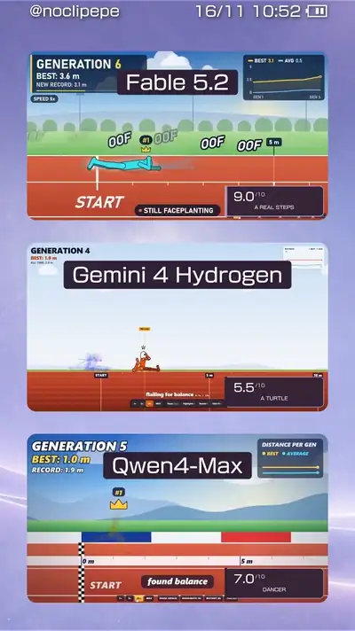</a><br><a href="https://www.sandbase.ai/lab/ai-videos/qwen4-max/2122349082723176738?utm_source=github&utm_medium=readme&utm_campaign=awesome-qwen4-max&utm_content=card"><b>Neural network simulated walking animation</b></a><br><sub><a href="https://x.com/noclipepe/status/2122349082723176738">@noclipepe</a> · 0:58</sub></td></tr>
</table>

</details>

<a id="motion-graphics"></a>

## Motion graphics

<table>
<tr><td width="33%" valign="top"><a href="https://www.sandbase.ai/lab/media/x/qwen4-max/2120345166997324170/video.mp4"></a><br><a href="https://www.sandbase.ai/lab/ai-videos/qwen4-max/2120345166997324170?utm_source=github&utm_medium=readme&utm_campaign=awesome-qwen4-max&utm_content=card"><b>Animated SVG of a pelican riding a bike</b></a><br><sub><a href="https://x.com/leo114119/status/2120345166997324170">@leo114119</a> · 0:33</sub></td><td width="33%" valign="top"><a href="https://www.sandbase.ai/lab/media/x/qwen4-max/2120356035181654391/video.mp4">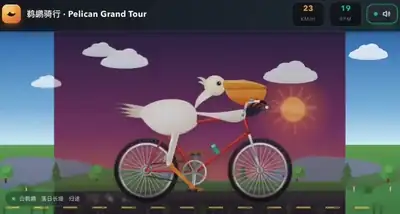</a><br><a href="https://www.sandbase.ai/lab/ai-videos/qwen4-max/2120356035181654391?utm_source=github&utm_medium=readme&utm_campaign=awesome-qwen4-max&utm_content=card"><b>Pelican Riding a Bicycle SVG Animation</b></a><br><sub><a href="https://x.com/xiax0603/status/2120356035181654391">@xiax0603</a> · 0:33</sub></td><td width="33%" valign="top"><a href="https://www.sandbase.ai/lab/media/x/qwen4-max/2120386245658624446/video.mp4">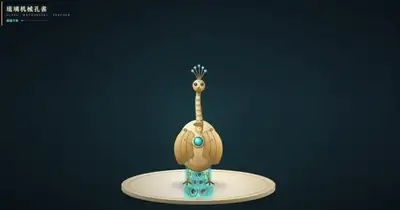</a><br><a href="https://www.sandbase.ai/lab/ai-videos/qwen4-max/2120386245658624446?utm_source=github&utm_medium=readme&utm_campaign=awesome-qwen4-max&utm_content=card"><b>Glazed Mechanical Peacock Displaying Feathers in SVG</b></a><br><sub><a href="https://x.com/leo114119/status/2120386245658624446">@leo114119</a> · 0:31</sub></td></tr>
<tr><td width="33%" valign="top"><a href="https://www.sandbase.ai/lab/media/x/qwen4-max/2120400676379365543/video.mp4">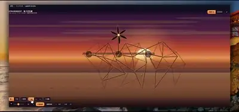</a><br><a href="https://www.sandbase.ai/lab/ai-videos/qwen4-max/2120400676379365543?utm_source=github&utm_medium=readme&utm_campaign=awesome-qwen4-max&utm_content=card"><b>Pelican Riding Bicycle and Dynamic Kinetic Visuals</b></a><br><sub><a href="https://x.com/LufzzLiz/status/2120400676379365543">@LufzzLiz</a> · 0:52</sub></td><td width="33%" valign="top"><a href="https://www.sandbase.ai/lab/media/x/qwen4-max/2121475034296520920/video.mp4">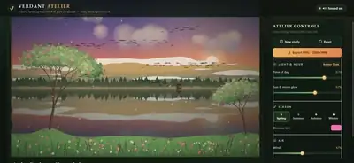</a><br><a href="https://www.sandbase.ai/lab/ai-videos/qwen4-max/2121475034296520920?utm_source=github&utm_medium=readme&utm_campaign=awesome-qwen4-max&utm_content=card"><b>Beautiful Nature Scene Drawn in JavaScript</b></a><br><sub><a href="https://x.com/badboy999654/status/2121475034296520920">@badboy999654</a> · 2:48 · <a href="https://www.sandbase.ai/lab/ai-videos/qwen4-max/2121475034296520920?utm_source=github&utm_medium=readme&utm_campaign=awesome-qwen4-max&utm_content=card">prompt</a></sub></td><td width="33%" valign="top"><a href="https://www.sandbase.ai/lab/media/x/qwen4-max/2121531028485628340/video.mp4">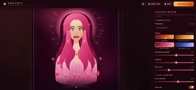</a><br><a href="https://www.sandbase.ai/lab/ai-videos/qwen4-max/2121531028485628340?utm_source=github&utm_medium=readme&utm_campaign=awesome-qwen4-max&utm_content=card"><b>SVG depiction of the hottest woman on earth</b></a><br><sub><a href="https://x.com/badboy999654/status/2121531028485628340">@badboy999654</a> · 1:07</sub></td></tr>
</table>

<details>
<summary><b>Show all 13</b></summary>

<table>
<tr><td width="33%" valign="top"><a href="https://www.sandbase.ai/lab/media/x/qwen4-max/2121532630009282782/video.mp4"></a><br><a href="https://www.sandbase.ai/lab/ai-videos/qwen4-max/2121532630009282782?utm_source=github&utm_medium=readme&utm_campaign=awesome-qwen4-max&utm_content=card"><b>PS4 Controller Created in SVG</b></a><br><sub><a href="https://x.com/badboy999654/status/2121532630009282782">@badboy999654</a> · 2:29</sub></td><td width="33%" valign="top"><a href="https://www.sandbase.ai/lab/media/x/qwen4-max/2122153465925308590/video.mp4"></a><br><a href="https://www.sandbase.ai/lab/ai-videos/qwen4-max/2122153465925308590?utm_source=github&utm_medium=readme&utm_campaign=awesome-qwen4-max&utm_content=card"><b>Chip benchmarks test animation with Qwen 4 Max</b></a><br><sub><a href="https://x.com/SPAC89/status/2122153465925308590">@SPAC89</a> · 0:25</sub></td><td width="33%" valign="top"><a href="https://www.sandbase.ai/lab/media/x/qwen4-max/2122163942759989447/video.mp4">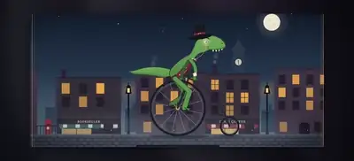</a><br><a href="https://www.sandbase.ai/lab/ai-videos/qwen4-max/2122163942759989447?utm_source=github&utm_medium=readme&utm_campaign=awesome-qwen4-max&utm_content=card"><b>Animated penny farthing bicycle and SVG test</b></a><br><sub><a href="https://x.com/atomtanstudio/status/2122163942759989447">@atomtanstudio</a> · 0:16</sub></td></tr>
<tr><td width="33%" valign="top"><a href="https://www.sandbase.ai/lab/media/x/qwen4-max/2122165587497685266/video.mp4"></a><br><a href="https://www.sandbase.ai/lab/ai-videos/qwen4-max/2122165587497685266?utm_source=github&utm_medium=readme&utm_campaign=awesome-qwen4-max&utm_content=card"><b>Pelican larping as Santa in SVG</b></a><br><sub><a href="https://x.com/badboy999654/status/2122165587497685266">@badboy999654</a> · 1:04</sub></td><td width="33%" valign="top"><a href="https://www.sandbase.ai/lab/media/x/qwen4-max/2122169039061750020/video.mp4">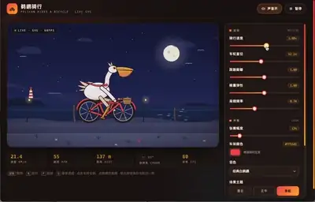</a><br><a href="https://www.sandbase.ai/lab/ai-videos/qwen4-max/2122169039061750020?utm_source=github&utm_medium=readme&utm_campaign=awesome-qwen4-max&utm_content=card"><b>SVG pelican riding a bicycle animation</b></a><br><sub><a href="https://x.com/Aurora0x3f/status/2122169039061750020">@Aurora0x3f</a> · 0:38 · <a href="https://www.sandbase.ai/lab/ai-videos/qwen4-max/2122169039061750020?utm_source=github&utm_medium=readme&utm_campaign=awesome-qwen4-max&utm_content=card">prompt</a></sub></td><td width="33%" valign="top"><a href="https://www.sandbase.ai/lab/media/x/qwen4-max/2122304927732998401/video.mp4">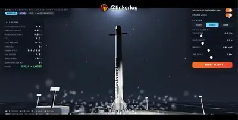</a><br><a href="https://www.sandbase.ai/lab/ai-videos/qwen4-max/2122304927732998401?utm_source=github&utm_medium=readme&utm_campaign=awesome-qwen4-max&utm_content=card"><b>Cinematic replay generated with Qwen 4 Max</b></a><br><sub><a href="https://x.com/tinkerlog/status/2122304927732998401">@tinkerlog</a> · 1:33</sub></td></tr>
<tr><td width="33%" valign="top"><a href="https://www.sandbase.ai/lab/media/x/qwen4-max/2122314819495981517/video.mp4"></a><br><a href="https://www.sandbase.ai/lab/ai-videos/qwen4-max/2122314819495981517?utm_source=github&utm_medium=readme&utm_campaign=awesome-qwen4-max&utm_content=card"><b>Qwen 4 Max test in Grok Bot Video Studio</b></a><br><sub><a href="https://x.com/MichaelGannotti/status/2122314819495981517">@MichaelGannotti</a> · 1:50</sub></td></tr>
</table>

</details>

<a id="game"></a>

## Games

<table>
<tr><td width="33%" valign="top"><a href="https://www.sandbase.ai/lab/media/x/qwen4-max/2120492162148384834/video.mp4"></a><br><a href="https://www.sandbase.ai/lab/ai-videos/qwen4-max/2120492162148384834?utm_source=github&utm_medium=readme&utm_campaign=awesome-qwen4-max&utm_content=card"><b>Replicating a Game in a Single HTML File</b></a><br><sub><a href="https://x.com/LufzzLiz/status/2120492162148384834">@LufzzLiz</a> · 1:13</sub></td><td width="33%" valign="top"><a href="https://www.sandbase.ai/lab/media/x/qwen4-max/2122018725977010388/video.mp4">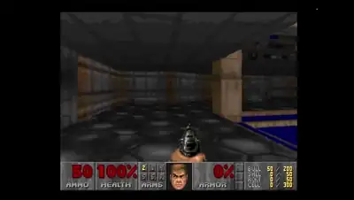</a><br><a href="https://www.sandbase.ai/lab/ai-videos/qwen4-max/2122018725977010388?utm_source=github&utm_medium=readme&utm_campaign=awesome-qwen4-max&utm_content=card"><b>Doom renderer converted to Gaussian splats</b></a><br><sub><a href="https://x.com/DrTBehrens/status/2122018725977010388">@DrTBehrens</a> · 0:49</sub></td><td width="33%" valign="top"><a href="https://www.sandbase.ai/lab/media/x/qwen4-max/2122161410805321796/video.mp4">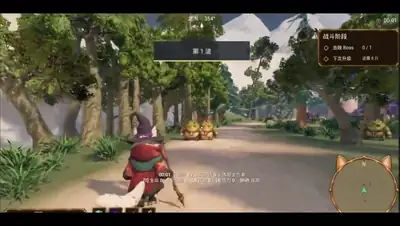</a><br><a href="https://www.sandbase.ai/lab/ai-videos/qwen4-max/2122161410805321796?utm_source=github&utm_medium=readme&utm_campaign=awesome-qwen4-max&utm_content=card"><b>A playable game built in Unity</b></a><br><sub><a href="https://x.com/intheworldofai/status/2122161410805321796">@intheworldofai</a> · 0:51</sub></td></tr>
<tr><td width="33%" valign="top"><a href="https://www.sandbase.ai/lab/media/x/qwen4-max/2122179851901968466/video.mp4"></a><br><a href="https://www.sandbase.ai/lab/ai-videos/qwen4-max/2122179851901968466?utm_source=github&utm_medium=readme&utm_campaign=awesome-qwen4-max&utm_content=card"><b>A single file 3D shooting game</b></a><br><sub><a href="https://x.com/niandwo/status/2122179851901968466">@niandwo</a> · 0:24 · <a href="https://www.sandbase.ai/lab/ai-videos/qwen4-max/2122179851901968466?utm_source=github&utm_medium=readme&utm_campaign=awesome-qwen4-max&utm_content=card">prompt</a></sub></td><td width="33%" valign="top"><a href="https://www.sandbase.ai/lab/media/x/qwen4-max/2122347804891009166/video.mp4">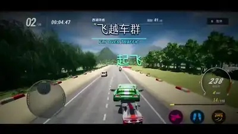</a><br><a href="https://www.sandbase.ai/lab/ai-videos/qwen4-max/2122347804891009166?utm_source=github&utm_medium=readme&utm_campaign=awesome-qwen4-max&utm_content=card"><b>Qwen4-Max capability for game engine asset building</b></a><br><sub><a href="https://x.com/wildmindai/status/2122347804891009166">@wildmindai</a> · 0:44</sub></td></tr>
</table>

<a id="ui-demo"></a>

## Product UI

<table>
<tr><td width="33%" valign="top"><a href="https://www.sandbase.ai/lab/media/x/qwen4-max/2122164935761260584/video.mp4"></a><br><a href="https://www.sandbase.ai/lab/ai-videos/qwen4-max/2122164935761260584?utm_source=github&utm_medium=readme&utm_campaign=awesome-qwen4-max&utm_content=card"><b>Playable violin web app with 3D elements</b></a><br><sub><a href="https://x.com/he1000se/status/2122164935761260584">@he1000se</a> · 0:28 · <a href="https://www.sandbase.ai/lab/ai-videos/qwen4-max/2122164935761260584?utm_source=github&utm_medium=readme&utm_campaign=awesome-qwen4-max&utm_content=card">prompt</a></sub></td></tr>
</table>

<a id="kinetic-type"></a>

## Kinetic type

<table>
<tr><td width="33%" valign="top"><a href="https://www.sandbase.ai/lab/media/x/qwen4-max/2120414419230605560/video.mp4"></a><br><a href="https://www.sandbase.ai/lab/ai-videos/qwen4-max/2120414419230605560?utm_source=github&utm_medium=readme&utm_campaign=awesome-qwen4-max&utm_content=card"><b>An animated SVG of a pelican riding a bicycle</b></a><br><sub><a href="https://x.com/xiangxiang103/status/2120414419230605560">@xiangxiang103</a> · 2:01 · <a href="https://www.sandbase.ai/lab/ai-videos/qwen4-max/2120414419230605560?utm_source=github&utm_medium=readme&utm_campaign=awesome-qwen4-max&utm_content=card">prompt</a></sub></td></tr>
</table>

<a id="explainer"></a>

## Explainers

<table>
<tr><td width="33%" valign="top"><a href="https://www.sandbase.ai/lab/media/x/qwen4-max/2122233643188068773/video.mp4"></a><br><a href="https://www.sandbase.ai/lab/ai-videos/qwen4-max/2122233643188068773?utm_source=github&utm_medium=readme&utm_campaign=awesome-qwen4-max&utm_content=card"><b>Multi-agent workflow simulation using Qwen4-Max</b></a><br><sub><a href="https://x.com/rlaope/status/2122233643188068773">@rlaope</a> · 0:15</sub></td></tr>
</table>

<a id="comparison"></a>

## Tests & comparisons

<table>
<tr><td width="33%" valign="top"><a href="https://www.sandbase.ai/lab/media/x/qwen4-max/2120383891605434723/video.mp4">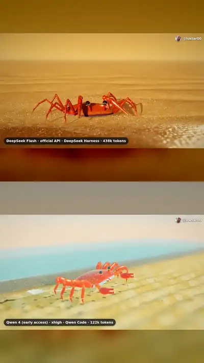</a><br><a href="https://www.sandbase.ai/lab/ai-videos/qwen4-max/2120383891605434723?utm_source=github&utm_medium=readme&utm_campaign=awesome-qwen4-max&utm_content=card"><b>Crab on the beach model comparison</b></a><br><sub><a href="https://x.com/loktar00/status/2120383891605434723">@loktar00</a> · 0:30</sub></td><td width="33%" valign="top"><a href="https://www.sandbase.ai/lab/media/x/qwen4-max/2120398335098118335/video.mp4">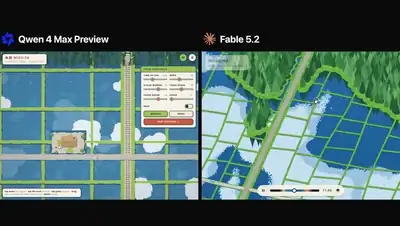</a><br><a href="https://www.sandbase.ai/lab/ai-videos/qwen4-max/2120398335098118335?utm_source=github&utm_medium=readme&utm_campaign=awesome-qwen4-max&utm_content=card"><b>Game Generation Comparison Between Fable and Qwen</b></a><br><sub><a href="https://x.com/fawnunwrap/status/2120398335098118335">@fawnunwrap</a> · 0:36</sub></td><td width="33%" valign="top"><a href="https://www.sandbase.ai/lab/media/x/qwen4-max/2120446429718086142/video.mp4">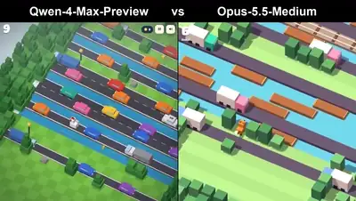</a><br><a href="https://www.sandbase.ai/lab/ai-videos/qwen4-max/2120446429718086142?utm_source=github&utm_medium=readme&utm_campaign=awesome-qwen4-max&utm_content=card"><b>Crossy Road game generated by AI models</b></a><br><sub><a href="https://x.com/markksantos/status/2120446429718086142">@markksantos</a> · 0:40 · <a href="https://www.sandbase.ai/lab/ai-videos/qwen4-max/2120446429718086142?utm_source=github&utm_medium=readme&utm_campaign=awesome-qwen4-max&utm_content=card">prompt</a></sub></td></tr>
<tr><td width="33%" valign="top"><a href="https://www.sandbase.ai/lab/media/x/qwen4-max/2120505982640120008/video.mp4">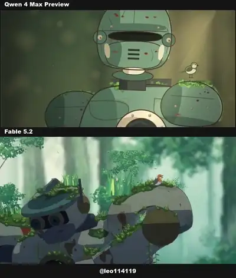</a><br><a href="https://www.sandbase.ai/lab/ai-videos/qwen4-max/2120505982640120008?utm_source=github&utm_medium=readme&utm_campaign=awesome-qwen4-max&utm_content=card"><b>Mossy robot story film comparison</b></a><br><sub><a href="https://x.com/AnikaCodes/status/2120505982640120008">@AnikaCodes</a> · 1:02</sub></td><td width="33%" valign="top"><a href="https://www.sandbase.ai/lab/media/x/minimax-m3-1-flash/2120544045797937387/video.mp4">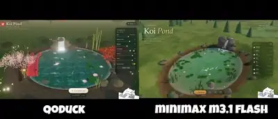</a><br><a href="https://www.sandbase.ai/lab/ai-videos/qwen4-max/2120544045797937387?utm_source=github&utm_medium=readme&utm_campaign=awesome-qwen4-max&utm_content=card"><b>Side by side generation test between two models</b></a><br><sub><a href="https://x.com/notjazii/status/2120544045797937387">@notjazii</a> · 0:33</sub></td><td width="33%" valign="top"><a href="https://www.sandbase.ai/lab/media/x/qwen4-max/2120557983365271979/video.mp4">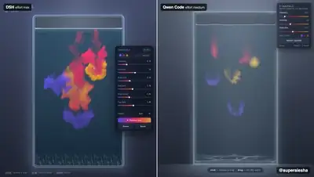</a><br><a href="https://www.sandbase.ai/lab/ai-videos/qwen4-max/2120557983365271979?utm_source=github&utm_medium=readme&utm_campaign=awesome-qwen4-max&utm_content=card"><b>Side by side ink in water simulation comparison</b></a><br><sub><a href="https://x.com/superalesha/status/2120557983365271979">@superalesha</a> · 0:22</sub></td></tr>
</table>

<details>
<summary><b>Show all 33</b></summary>

<table>
<tr><td width="33%" valign="top"><a href="https://www.sandbase.ai/lab/media/x/qwen4-max/2120631382099763414/video.mp4">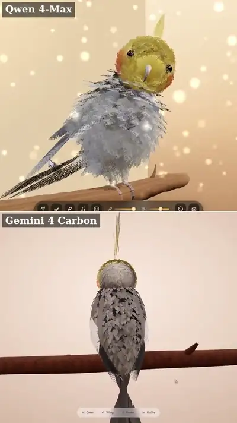</a><br><a href="https://www.sandbase.ai/lab/ai-videos/qwen4-max/2120631382099763414?utm_source=github&utm_medium=readme&utm_campaign=awesome-qwen4-max&utm_content=card"><b>Qwen 4 Max versus Gemini 4 Carbon</b></a><br><sub><a href="https://x.com/DrstaOne/status/2120631382099763414">@DrstaOne</a> · 0:43</sub></td><td width="33%" valign="top"><a href="https://www.sandbase.ai/lab/media/x/qwen4-max/2120697659941847244/video.mp4">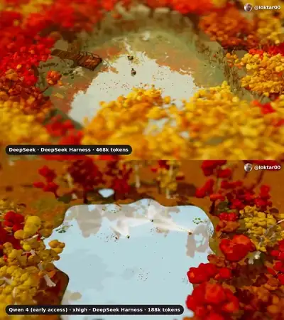</a><br><a href="https://www.sandbase.ai/lab/ai-videos/qwen4-max/2120697659941847244?utm_source=github&utm_medium=readme&utm_campaign=awesome-qwen4-max&utm_content=card"><b>DeepSeek Flash and Qwen 4 Max comparison</b></a><br><sub><a href="https://x.com/loktar00/status/2120697659941847244">@loktar00</a> · 0:30</sub></td><td width="33%" valign="top"><a href="https://www.sandbase.ai/lab/media/x/gemini-4-carbon/2120846360064692377/video.mp4">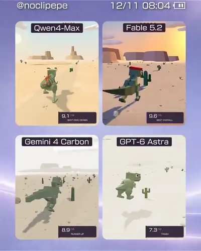</a><br><a href="https://www.sandbase.ai/lab/ai-videos/qwen4-max/2120846360064692377?utm_source=github&utm_medium=readme&utm_campaign=awesome-qwen4-max&utm_content=card"><b>Chrome Dino game recreation comparison</b></a><br><sub><a href="https://x.com/noclipepe/status/2120846360064692377">@noclipepe</a> · 0:28</sub></td></tr>
<tr><td width="33%" valign="top"><a href="https://www.sandbase.ai/lab/media/x/qwen4-max/2120949029647581552/video.mp4">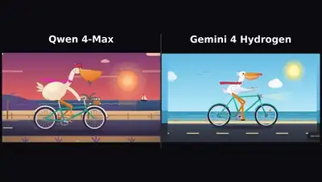</a><br><a href="https://www.sandbase.ai/lab/ai-videos/qwen4-max/2120949029647581552?utm_source=github&utm_medium=readme&utm_campaign=awesome-qwen4-max&utm_content=card"><b>Side-by-side prompt comparison of AI models</b></a><br><sub><a href="https://x.com/DrstaOne/status/2120949029647581552">@DrstaOne</a> · 0:31</sub></td><td width="33%" valign="top"><a href="https://www.sandbase.ai/lab/media/x/gemini-4-hydrogen/2121030532247261251/video.mp4"></a><br><a href="https://www.sandbase.ai/lab/ai-videos/qwen4-max/2121030532247261251?utm_source=github&utm_medium=readme&utm_campaign=awesome-qwen4-max&utm_content=card"><b>Yacht on Italian coast generated scene comparison</b></a><br><sub><a href="https://x.com/Chris_Wozniczek/status/2121030532247261251">@Chris_Wozniczek</a> · 1:10</sub></td><td width="33%" valign="top"><a href="https://www.sandbase.ai/lab/media/x/qwen4-max/2121130120530567601/video.mp4"></a><br><a href="https://www.sandbase.ai/lab/ai-videos/qwen4-max/2121130120530567601?utm_source=github&utm_medium=readme&utm_campaign=awesome-qwen4-max&utm_content=card"><b>Peacock riding a bike SVG animation comparison</b></a><br><sub><a href="https://x.com/SahilPanhotra/status/2121130120530567601">@SahilPanhotra</a> · 0:10</sub></td></tr>
<tr><td width="33%" valign="top"><a href="https://www.sandbase.ai/lab/media/x/gemini-4-hydrogen/2121219775170761044/video.mp4"></a><br><a href="https://www.sandbase.ai/lab/ai-videos/qwen4-max/2121219775170761044?utm_source=github&utm_medium=readme&utm_campaign=awesome-qwen4-max&utm_content=card"><b>Chrome Dino game generation benchmark test</b></a><br><sub><a href="https://x.com/noclipepe/status/2121219775170761044">@noclipepe</a> · 0:28</sub></td><td width="33%" valign="top"><a href="https://www.sandbase.ai/lab/media/x/gemini-4-hydrogen/2121305690585383385/video.mp4"></a><br><a href="https://www.sandbase.ai/lab/ai-videos/qwen4-max/2121305690585383385?utm_source=github&utm_medium=readme&utm_campaign=awesome-qwen4-max&utm_content=card"><b>Model generation speed comparison across three models</b></a><br><sub><a href="https://x.com/AnikaCodes/status/2121305690585383385">@AnikaCodes</a> · 0:20</sub></td><td width="33%" valign="top"><a href="https://www.sandbase.ai/lab/media/x/deepseek-v4-1-flash-1017/2121587078970720516/video.mp4"></a><br><a href="https://www.sandbase.ai/lab/ai-videos/qwen4-max/2121587078970720516?utm_source=github&utm_medium=readme&utm_campaign=awesome-qwen4-max&utm_content=card"><b>3D star core temple generation speed comparison</b></a><br><sub><a href="https://x.com/BadEarsX/status/2121587078970720516">@BadEarsX</a> · 0:30</sub></td></tr>
<tr><td width="33%" valign="top"><a href="https://www.sandbase.ai/lab/media/x/qwen4-max/2121774514698662123/video.mp4"></a><br><a href="https://www.sandbase.ai/lab/ai-videos/qwen4-max/2121774514698662123?utm_source=github&utm_medium=readme&utm_campaign=awesome-qwen4-max&utm_content=card"><b>Gaussian splat night oak tree scene comparison</b></a><br><sub><a href="https://x.com/loktar00/status/2121774514698662123">@loktar00</a> · 0:36</sub></td><td width="33%" valign="top"><a href="https://www.sandbase.ai/lab/media/x/gemini-4-carbon/2121838448940286326/video.mp4"></a><br><a href="https://www.sandbase.ai/lab/ai-videos/qwen4-max/2121838448940286326?utm_source=github&utm_medium=readme&utm_campaign=awesome-qwen4-max&utm_content=card"><b>Nine AI models generate pelican cycling animation</b></a><br><sub><a href="https://x.com/Emproof31825/status/2121838448940286326">@Emproof31825</a> · 4:07 · <a href="https://www.sandbase.ai/lab/ai-videos/qwen4-max/2121838448940286326?utm_source=github&utm_medium=readme&utm_campaign=awesome-qwen4-max&utm_content=card">prompt</a></sub></td><td width="33%" valign="top"><a href="https://www.sandbase.ai/lab/media/x/qwen4-max/2121947540509831302/video.mp4"></a><br><a href="https://www.sandbase.ai/lab/ai-videos/qwen4-max/2121947540509831302?utm_source=github&utm_medium=readme&utm_campaign=awesome-qwen4-max&utm_content=card"><b>Two dragons fighting over a mountain temple</b></a><br><sub><a href="https://x.com/DrstaOne/status/2121947540509831302">@DrstaOne</a> · 0:32</sub></td></tr>
<tr><td width="33%" valign="top"><a href="https://www.sandbase.ai/lab/media/x/kimi-k3-1/2122152569564983357/video.mp4"></a><br><a href="https://www.sandbase.ai/lab/ai-videos/qwen4-max/2122152569564983357?utm_source=github&utm_medium=readme&utm_campaign=awesome-qwen4-max&utm_content=card"><b>Comparing interview templates in Qwen and Kimi</b></a><br><sub><a href="https://x.com/oliverjohansson/status/2122152569564983357">@oliverjohansson</a> · 0:33</sub></td><td width="33%" valign="top"><a href="https://www.sandbase.ai/lab/media/x/qwen4-max/2122182167799451659/video.mp4"></a><br><a href="https://www.sandbase.ai/lab/ai-videos/qwen4-max/2122182167799451659?utm_source=github&utm_medium=readme&utm_campaign=awesome-qwen4-max&utm_content=card"><b>Three model comparison of pelican riding bicycle</b></a><br><sub><a href="https://x.com/hiwise_aigc/status/2122182167799451659">@hiwise_aigc</a> · 0:37</sub></td><td width="33%" valign="top"><a href="https://www.sandbase.ai/lab/media/x/qwen4-max/2122213962011881801/video.mp4"></a><br><a href="https://www.sandbase.ai/lab/ai-videos/qwen4-max/2122213962011881801?utm_source=github&utm_medium=readme&utm_campaign=awesome-qwen4-max&utm_content=card"><b>Interactive 3D Solar System Coding Comparison</b></a><br><sub><a href="https://x.com/Frtnel/status/2122213962011881801">@Frtnel</a> · 1:08 · <a href="https://www.sandbase.ai/lab/ai-videos/qwen4-max/2122213962011881801?utm_source=github&utm_medium=readme&utm_campaign=awesome-qwen4-max&utm_content=card">prompt</a></sub></td></tr>
<tr><td width="33%" valign="top"><a href="https://www.sandbase.ai/lab/media/x/qwen4-max/2122221106304352257/video.mp4"></a><br><a href="https://www.sandbase.ai/lab/ai-videos/qwen4-max/2122221106304352257?utm_source=github&utm_medium=readme&utm_campaign=awesome-qwen4-max&utm_content=card"><b>Electric motor animation and physics simulation comparison</b></a><br><sub><a href="https://x.com/analogalok/status/2122221106304352257">@analogalok</a> · 0:13 · <a href="https://www.sandbase.ai/lab/ai-videos/qwen4-max/2122221106304352257?utm_source=github&utm_medium=readme&utm_campaign=awesome-qwen4-max&utm_content=card">prompt</a></sub></td><td width="33%" valign="top"><a href="https://www.sandbase.ai/lab/media/x/qwen4-max/2122275275132072029/video.mp4"></a><br><a href="https://www.sandbase.ai/lab/ai-videos/qwen4-max/2122275275132072029?utm_source=github&utm_medium=readme&utm_campaign=awesome-qwen4-max&utm_content=card"><b>Qwen 4 Max vs Claude Opus 5.5 pelican benchmark</b></a><br><sub><a href="https://x.com/atomic_chat_hq/status/2122275275132072029">@atomic_chat_hq</a> · 0:07 · <a href="https://www.sandbase.ai/lab/ai-videos/qwen4-max/2122275275132072029?utm_source=github&utm_medium=readme&utm_campaign=awesome-qwen4-max&utm_content=card">prompt</a></sub></td><td width="33%" valign="top"><a href="https://www.sandbase.ai/lab/media/x/qwen4-max/2122278047403348332/video.mp4"></a><br><a href="https://www.sandbase.ai/lab/ai-videos/qwen4-max/2122278047403348332?utm_source=github&utm_medium=readme&utm_campaign=awesome-qwen4-max&utm_content=card"><b>Qwen 4 Max vs Claude Opus 5.5 pelican benchmark</b></a><br><sub><a href="https://x.com/atomic_chat_hq/status/2122278047403348332">@atomic_chat_hq</a> · 0:07 · <a href="https://www.sandbase.ai/lab/ai-videos/qwen4-max/2122278047403348332?utm_source=github&utm_medium=readme&utm_campaign=awesome-qwen4-max&utm_content=card">prompt</a></sub></td></tr>
<tr><td width="33%" valign="top"><a href="https://www.sandbase.ai/lab/media/x/qwen4-max/2122292875660505326/video.mp4"></a><br><a href="https://www.sandbase.ai/lab/ai-videos/qwen4-max/2122292875660505326?utm_source=github&utm_medium=readme&utm_campaign=awesome-qwen4-max&utm_content=card"><b>Mount Fuji 3D model comparison result</b></a><br><sub><a href="https://x.com/exploraX_/status/2122292875660505326">@exploraX_</a> · 0:54</sub></td><td width="33%" valign="top"><a href="https://www.sandbase.ai/lab/media/x/gemini-4-carbon/2122296954793455971/video.mp4"></a><br><a href="https://www.sandbase.ai/lab/ai-videos/qwen4-max/2122296954793455971?utm_source=github&utm_medium=readme&utm_campaign=awesome-qwen4-max&utm_content=card"><b>Comparing four AI models for coastal ride generation</b></a><br><sub><a href="https://x.com/Offloop/status/2122296954793455971">@Offloop</a> · 0:06 · <a href="https://www.sandbase.ai/lab/ai-videos/qwen4-max/2122296954793455971?utm_source=github&utm_medium=readme&utm_campaign=awesome-qwen4-max&utm_content=card">prompt</a></sub></td><td width="33%" valign="top"><a href="https://www.sandbase.ai/lab/media/x/hy4-flash/2122315149029826951/video.mp4"></a><br><a href="https://www.sandbase.ai/lab/ai-videos/qwen4-max/2122315149029826951?utm_source=github&utm_medium=readme&utm_campaign=awesome-qwen4-max&utm_content=card"><b>Tandem ride SVG animation model comparison</b></a><br><sub><a href="https://x.com/marcthecreatorr/status/2122315149029826951">@marcthecreatorr</a> · 0:12</sub></td></tr>
<tr><td width="33%" valign="top"><a href="https://www.sandbase.ai/lab/media/x/gemini-4-hydrogen/2122345434567905500/video.mp4"></a><br><a href="https://www.sandbase.ai/lab/ai-videos/qwen4-max/2122345434567905500?utm_source=github&utm_medium=readme&utm_campaign=awesome-qwen4-max&utm_content=card"><b>Building a game in a single HTML file comparison</b></a><br><sub><a href="https://x.com/x_Kuro_/status/2122345434567905500">@x_Kuro_</a> · 0:16 · <a href="https://www.sandbase.ai/lab/ai-videos/qwen4-max/2122345434567905500?utm_source=github&utm_medium=readme&utm_campaign=awesome-qwen4-max&utm_content=card">prompt</a></sub></td><td width="33%" valign="top"><a href="https://www.sandbase.ai/lab/media/x/gemini-4-hydrogen/2122353119749361808/video.mp4"></a><br><a href="https://www.sandbase.ai/lab/ai-videos/qwen4-max/2122353119749361808?utm_source=github&utm_medium=readme&utm_campaign=awesome-qwen4-max&utm_content=card"><b>Animated SVG of a pelican riding animals</b></a><br><sub><a href="https://x.com/RezAIT00/status/2122353119749361808">@RezAIT00</a> · 0:18</sub></td><td width="33%" valign="top"><a href="https://www.sandbase.ai/lab/media/x/qwen4-max/2122379791710273721/video.mp4"></a><br><a href="https://www.sandbase.ai/lab/ai-videos/qwen4-max/2122379791710273721?utm_source=github&utm_medium=readme&utm_campaign=awesome-qwen4-max&utm_content=card"><b>Iterative improvements for cinematic sushi animation</b></a><br><sub><a href="https://x.com/stevibe/status/2122379791710273721">@stevibe</a> · 0:24</sub></td></tr>
<tr><td width="33%" valign="top"><a href="https://www.sandbase.ai/lab/media/x/qwen4-max/2122387989682909513/video.mp4"></a><br><a href="https://www.sandbase.ai/lab/ai-videos/qwen4-max/2122387989682909513?utm_source=github&utm_medium=readme&utm_campaign=awesome-qwen4-max&utm_content=card"><b>Comparing Qwen4-Max and Claude Opus for voxel animation</b></a><br><sub><a href="https://x.com/ottollm/status/2122387989682909513">@ottollm</a> · 0:30 · <a href="https://www.sandbase.ai/lab/ai-videos/qwen4-max/2122387989682909513?utm_source=github&utm_medium=readme&utm_campaign=awesome-qwen4-max&utm_content=card">prompt</a></sub></td><td width="33%" valign="top"><a href="https://www.sandbase.ai/lab/media/x/qwen4-max/2122408325501391058/video.mp4"></a><br><a href="https://www.sandbase.ai/lab/ai-videos/qwen4-max/2122408325501391058?utm_source=github&utm_medium=readme&utm_campaign=awesome-qwen4-max&utm_content=card"><b>Four models building animated futuristic city</b></a><br><sub><a href="https://x.com/RezAIT00/status/2122408325501391058">@RezAIT00</a> · 0:10</sub></td><td width="33%" valign="top"><a href="https://www.sandbase.ai/lab/media/x/qwen4-max/2122432152340209964/video.mp4"></a><br><a href="https://www.sandbase.ai/lab/ai-videos/qwen4-max/2122432152340209964?utm_source=github&utm_medium=readme&utm_campaign=awesome-qwen4-max&utm_content=card"><b>Comparison of four AI models using the Alpine Gold prompt</b></a><br><sub><a href="https://x.com/EnvolDev/status/2122432152340209964">@EnvolDev</a> · 0:25 · <a href="https://www.sandbase.ai/lab/ai-videos/qwen4-max/2122432152340209964?utm_source=github&utm_medium=readme&utm_campaign=awesome-qwen4-max&utm_content=card">prompt</a></sub></td></tr>
</table>

</details>

**[See all 78 on SandBase Lab →](https://www.sandbase.ai/lab/ai-videos/qwen4-max?utm_source=github&utm_medium=readme&utm_campaign=awesome-qwen4-max&utm_content=section)**

<a id="recreate"></a>

## Recreate a video with Qwen 4 Max

Every video page on [SandBase Lab](https://www.sandbase.ai/lab/ai-videos/qwen4-max?utm_source=github&utm_medium=readme&utm_campaign=awesome-qwen4-max&utm_content=recreate) has a **Recreate** button: it sends the post to Qwen 4 Max in the Lab text arena and returns the code, ready to play in the browser.

With the API, Qwen 4 Max is `alibaba/qwen4-max` on SandBase (OpenAI-compatible). Put a prompt in `prompt.txt`, create a key in the [console](https://www.sandbase.ai/console/keys?utm_source=github&utm_medium=readme&utm_campaign=awesome-qwen4-max), and run:

```bash
jq -n --rawfile prompt prompt.txt \
  '{model: "alibaba/qwen4-max", max_tokens: 128000, messages: [{role: "user", content: $prompt}]}' |
curl -sS --max-time 900 https://api.sandbase.ai/v1/chat/completions \
  -H "Authorization: Bearer $SANDBASE_API_KEY" \
  -H "Content-Type: application/json" \
  -d @- | jq -r '.choices[0].message.content' | sed '/^```/d' > qwen4-max.html
```

Open `qwen4-max.html` in a browser, or run it in a [SandBase Sandbox](https://www.sandbase.ai/landing/sandbox?utm_source=github&utm_medium=readme&utm_campaign=awesome-qwen4-max) to keep generated code isolated. The call above asks for 128,000 `max_tokens` because creators' runs reported 172K and 197K tokens; raise it for long pages. Full walkthrough: [tutorial](docs/tutorial.md). Pricing: [model page](https://www.sandbase.ai/model/alibaba/qwen4-max?utm_source=github&utm_medium=readme&utm_campaign=awesome-qwen4-max).

<a id="faq"></a>

## FAQ

### What is Qwen 4 Max?

Qwen4-Max is Alibaba's Qwen 4 Max model. The Lab collection was announced on November 11, 2026, and the creators here tested the preview build; @xiangxiang103 reports it launched in preview on Qoder and says no parameter count or benchmark scores were published. SandBase lists a context window of 1,000,000 tokens. On SandBase it is `alibaba/qwen4-max`. Source: `sandbase inspect alibaba/qwen4-max`.

### How are these Qwen 4 Max videos made?

The model doesn't render video. It writes code, usually one HTML page (Three.js, WebGL, canvas or SVG), and the creator records the page playing. Some creators ran it through a coding harness such as OpenCode or Qwen Code, and one drove Blender through an MCP connection. See the [tutorial](docs/tutorial.md).

### Where do I find the prompt for a video?

Videos tagged **prompt** come with the creator's prompt on their Lab page. The [prompt index](docs/prompts.md) lists all of them.

### How do I write a good Qwen 4 Max prompt?

Name one self-contained HTML file and the renderer you want (Three.js, WebGL, canvas or SVG), state the constraints, ask for a one-shot build with no fixes, and say which harness and reasoning setting you used. Details and a template: [prompt guide](docs/prompt-guide.md).

### How do I use the Qwen 4 Max API?

On SandBase the model id is `alibaba/qwen4-max` on the OpenAI-compatible `/v1/chat/completions` endpoint, and one key works for every model. See [Recreate](#recreate) and the [model page](https://www.sandbase.ai/model/alibaba/qwen4-max?utm_source=github&utm_medium=readme&utm_campaign=awesome-qwen4-max).

### Is Qwen 4 Max better than Claude Opus 5.5, Claude Sonnet 5.5 or Gemini 4 Hydrogen?

Creators disagree. In an electric-motor test @analogalok found Gemini 4 Hydrogen did the best overall job on 3D realism and clarity. @markksantos says Opus won a Crossy Road build, "but it was definitely close". @Frtnel reports Opus 5.5 judged its WebGL solar system to be close to Sonnet 5.5. The Lab [Evals boards](https://www.sandbase.ai/leaderboards?utm_source=github&utm_medium=readme&utm_campaign=awesome-qwen4-max) and [Pelican Test](https://www.sandbase.ai/arena/pelican-test?utm_source=github&utm_medium=readme&utm_campaign=awesome-qwen4-max) had no Qwen 4 Max row when this list was built. Details: [model comparison](docs/model-comparison.md).

### How much does one video cost?

The list price on SandBase is $1.666667 per million input tokens and $5 per million output tokens, and cached input reads bill at 5% of the input rate. Creators in this collection posted token counts, not dollar totals, so multiply the `usage` field by those rates. Source: `sandbase inspect alibaba/qwen4-max` and the model page.

### Can I reuse these videos?

No, not by default. They belong to their creators. See [MEDIA-RIGHTS](MEDIA-RIGHTS.md).

<a id="contribute"></a>

## Suggest a video

Know a Qwen 4 Max creation that should be here? [Open a submission](https://github.com/sandbase-lab/awesome-qwen4-max/issues/new?template=submit-video.yml) with the original X post. Accepted posts are added on SandBase Lab and show up here on the next daily sync. If this list helped you, a ⭐ helps others find it.

## Credits & rights

Every video, prompt and post belongs to its creator. Cards credit the author and link to the original post. The MIT license covers this repository's scripts only. To correct a credit or remove a video, see [MEDIA-RIGHTS](MEDIA-RIGHTS.md).

Not affiliated with or endorsed by Qwen (Alibaba).

---

Maintained by [SandBase Lab](https://www.sandbase.ai/lab/?utm_source=github&utm_medium=readme&utm_campaign=awesome-qwen4-max) · [All AI video collections](https://www.sandbase.ai/lab/ai-videos?utm_source=github&utm_medium=readme&utm_campaign=awesome-qwen4-max)
