# Awesome Qwen 4 Max

[English](README.md) · 简体中文

[](https://awesome.re) [](#contents) [](docs/zh-CN/prompts.md) [](https://github.com/sandbase-lab/awesome-qwen4-max/actions/workflows/sync.yml) [](https://www.sandbase.ai/model/alibaba/qwen4-max?utm_source=github&utm_medium=readme&utm_campaign=awesome-qwen4-max)

[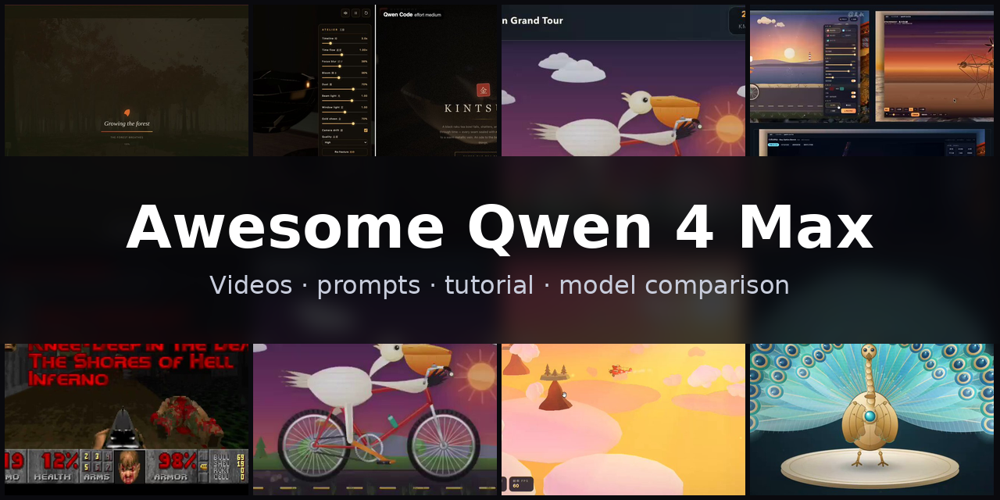](https://www.sandbase.ai/lab/ai-videos/qwen4-max?lang=zh-CN&utm_source=github&utm_medium=readme&utm_campaign=awesome-qwen4-max&utm_content=banner)

精选 **Qwen 4 Max 案例**合集：用 Qwen4-Max（阿里巴巴的 Qwen 4 Max 模型，11 月 11 日公布，创作者在预览版上测试）做出的视频、提示词和演示。包括 Three.js 与 WebGL 3D 场景、SVG 与 Canvas 动画、动效、产品界面和可在浏览器里玩的游戏，大多是模型根据提示词写成的单文件网页，均注明作者并链接原帖。

共 **46 条视频**，来自 **27 位创作者** · **12 条**附作者提示词 · 每天从 [SandBase Lab](https://www.sandbase.ai/lab/ai-videos/qwen4-max?lang=zh-CN&utm_source=github&utm_medium=readme&utm_campaign=awesome-qwen4-max&utm_content=stats) 同步

## 从这里开始

| 我想… | 去这里 |
|---|---|
| 看视频 | 在下方 [按分类浏览](#contents)，或 [在 SandBase Lab 大屏播放](https://www.sandbase.ai/lab/ai-videos/qwen4-max?lang=zh-CN&utm_source=github&utm_medium=readme&utm_campaign=awesome-qwen4-max&utm_content=quickstart) |
| 复制提示词 | [提示词索引](docs/zh-CN/prompts.md)：所有附带提示词的视频 |
| 自己写提示词 | [提示词写法](docs/zh-CN/prompt-guide.md)：7 条写法和一个填空模板 |
| 做一个视频 | [教程](docs/zh-CN/tutorial.md)：提示词 → HTML → MP4，含 API、CLI 调用和录屏脚本 |
| 选模型 | [Qwen 4 Max 对比 Claude Opus 5.5、Claude Sonnet 5.5 和 Gemini 4 Hydrogen](docs/zh-CN/model-comparison.md) |
| 马上试试 | [在 Lab 竞技场运行 Qwen 4 Max](https://www.sandbase.ai/arena/text?models=alibaba%2Fqwen4-max&lang=zh-CN&utm_source=github&utm_medium=readme&utm_campaign=awesome-qwen4-max&utm_content=quickstart)，和其他模型并排对比 |

<a id="contents"></a>

## 目录

- [精选](#featured) (7)
- [3D 场景](#3d-scene) (12)
- [动效](#motion-graphics) (9)
- [游戏](#game) (3)
- [产品界面](#ui-demo) (1)
- [文字动效](#kinetic-type) (1)
- [测试对比](#comparison) (20)
- [用 Qwen 4 Max 复刻视频](#recreate)
- [常见问题](#faq)
- [推荐作品](#contribute)

点击预览图播放视频；点击标题前往 SandBase Lab 查看原帖、提示词，并一键 **复刻**；**@作者** 链接到 X 原帖。

<a id="featured"></a>

## 精选

<table>
<tr><td width="33%" valign="top"><a href="https://www.sandbase.ai/lab/media/x/qwen4-max/2120448740012265621/video.mp4">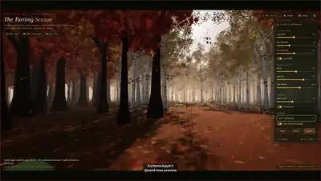</a><br><a href="https://www.sandbase.ai/lab/ai-videos/qwen4-max/2120448740012265621?lang=zh-CN&utm_source=github&utm_medium=readme&utm_campaign=awesome-qwen4-max&utm_content=card"><b>深秋时节的枫树与白桦树林</b></a><br><sub><a href="https://x.com/ItsmeAjayKV/status/2120448740012265621">@ItsmeAjayKV</a> · 1:36 · <a href="https://www.sandbase.ai/lab/ai-videos/qwen4-max/2120448740012265621?lang=zh-CN&utm_source=github&utm_medium=readme&utm_campaign=awesome-qwen4-max&utm_content=card">提示词</a></sub></td><td width="33%" valign="top"><a href="https://www.sandbase.ai/lab/media/x/qwen4-max/2120578444518166707/video.mp4">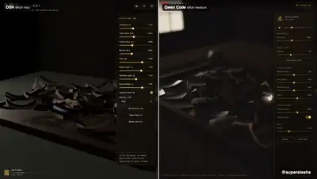</a><br><a href="https://www.sandbase.ai/lab/ai-videos/qwen4-max/2120578444518166707?lang=zh-CN&utm_source=github&utm_medium=readme&utm_campaign=awesome-qwen4-max&utm_content=card"><b>代码生成的金缮发光瓷碗场景</b></a><br><sub><a href="https://x.com/superalesha/status/2120578444518166707">@superalesha</a> · 0:22</sub></td><td width="33%" valign="top"><a href="https://www.sandbase.ai/lab/media/x/qwen4-max/2120345166997324170/video.mp4">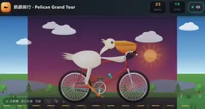</a><br><a href="https://www.sandbase.ai/lab/ai-videos/qwen4-max/2120345166997324170?lang=zh-CN&utm_source=github&utm_medium=readme&utm_campaign=awesome-qwen4-max&utm_content=card"><b>鹈鹕骑自行车的 SVG 动画测试</b></a><br><sub><a href="https://x.com/leo114119/status/2120345166997324170">@leo114119</a> · 0:33</sub></td></tr>
<tr><td width="33%" valign="top"><a href="https://www.sandbase.ai/lab/media/x/qwen4-max/2120400676379365543/video.mp4">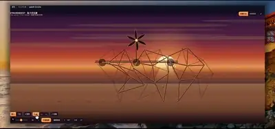</a><br><a href="https://www.sandbase.ai/lab/ai-videos/qwen4-max/2120400676379365543?lang=zh-CN&utm_source=github&utm_medium=readme&utm_campaign=awesome-qwen4-max&utm_content=card"><b>鹈鹕骑车与仿生兽动态前端效果</b></a><br><sub><a href="https://x.com/LufzzLiz/status/2120400676379365543">@LufzzLiz</a> · 0:52</sub></td><td width="33%" valign="top"><a href="https://www.sandbase.ai/lab/media/x/qwen4-max/2120414419230605560/video.mp4"></a><br><a href="https://www.sandbase.ai/lab/ai-videos/qwen4-max/2120414419230605560?lang=zh-CN&utm_source=github&utm_medium=readme&utm_campaign=awesome-qwen4-max&utm_content=card"><b>一只骑自行车的鹈鹕的 动画SVG</b></a><br><sub><a href="https://x.com/xiangxiang103/status/2120414419230605560">@xiangxiang103</a> · 2:01 · <a href="https://www.sandbase.ai/lab/ai-videos/qwen4-max/2120414419230605560?lang=zh-CN&utm_source=github&utm_medium=readme&utm_campaign=awesome-qwen4-max&utm_content=card">提示词</a></sub></td><td width="33%" valign="top"><a href="https://www.sandbase.ai/lab/media/x/qwen4-max/2122018725977010388/video.mp4">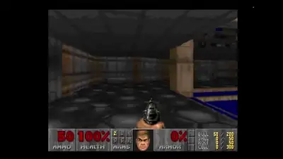</a><br><a href="https://www.sandbase.ai/lab/ai-videos/qwen4-max/2122018725977010388?lang=zh-CN&utm_source=github&utm_medium=readme&utm_campaign=awesome-qwen4-max&utm_content=card"><b>采用高斯泼溅渲染的毁灭战士重构</b></a><br><sub><a href="https://x.com/DrTBehrens/status/2122018725977010388">@DrTBehrens</a> · 0:49</sub></td></tr>
<tr><td width="33%" valign="top"><a href="https://www.sandbase.ai/lab/media/x/qwen4-max/2122164935761260584/video.mp4">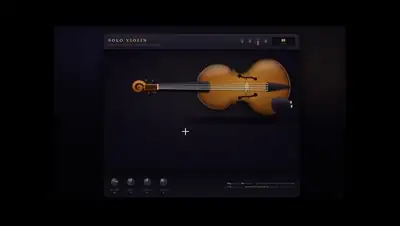</a><br><a href="https://www.sandbase.ai/lab/ai-videos/qwen4-max/2122164935761260584?lang=zh-CN&utm_source=github&utm_medium=readme&utm_campaign=awesome-qwen4-max&utm_content=card"><b>包含3D元素的可演奏小提琴网页应用</b></a><br><sub><a href="https://x.com/he1000se/status/2122164935761260584">@he1000se</a> · 0:28 · <a href="https://www.sandbase.ai/lab/ai-videos/qwen4-max/2122164935761260584?lang=zh-CN&utm_source=github&utm_medium=readme&utm_campaign=awesome-qwen4-max&utm_content=card">提示词</a></sub></td></tr>
</table>

<a id="3d-scene"></a>

## 3D 场景

<table>
<tr><td width="33%" valign="top"><a href="https://www.sandbase.ai/lab/media/x/qwen4-max/2120371909624033439/video.mp4">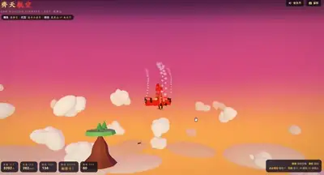</a><br><a href="https://www.sandbase.ai/lab/ai-videos/qwen4-max/2120371909624033439?lang=zh-CN&utm_source=github&utm_medium=readme&utm_campaign=awesome-qwen4-max&utm_content=card"><b>孙悟空开飞机的 HTML 3D 动画演示</b></a><br><sub><a href="https://x.com/leo114119/status/2120371909624033439">@leo114119</a> · 1:26</sub></td><td width="33%" valign="top"><a href="https://www.sandbase.ai/lab/media/x/qwen4-max/2120448740012265621/video.mp4"></a><br><a href="https://www.sandbase.ai/lab/ai-videos/qwen4-max/2120448740012265621?lang=zh-CN&utm_source=github&utm_medium=readme&utm_campaign=awesome-qwen4-max&utm_content=card"><b>深秋时节的枫树与白桦树林</b></a><br><sub><a href="https://x.com/ItsmeAjayKV/status/2120448740012265621">@ItsmeAjayKV</a> · 1:36 · <a href="https://www.sandbase.ai/lab/ai-videos/qwen4-max/2120448740012265621?lang=zh-CN&utm_source=github&utm_medium=readme&utm_campaign=awesome-qwen4-max&utm_content=card">提示词</a></sub></td><td width="33%" valign="top"><a href="https://www.sandbase.ai/lab/media/x/qwen4-max/2120578444518166707/video.mp4"></a><br><a href="https://www.sandbase.ai/lab/ai-videos/qwen4-max/2120578444518166707?lang=zh-CN&utm_source=github&utm_medium=readme&utm_campaign=awesome-qwen4-max&utm_content=card"><b>代码生成的金缮发光瓷碗场景</b></a><br><sub><a href="https://x.com/superalesha/status/2120578444518166707">@superalesha</a> · 0:22</sub></td></tr>
<tr><td width="33%" valign="top"><a href="https://www.sandbase.ai/lab/media/x/qwen4-max/2120598391738818728/video.mp4">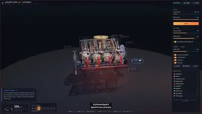</a><br><a href="https://www.sandbase.ai/lab/ai-videos/qwen4-max/2120598391738818728?lang=zh-CN&utm_source=github&utm_medium=readme&utm_campaign=awesome-qwen4-max&utm_content=card"><b>Three.js中的V8发动机剖面模拟</b></a><br><sub><a href="https://x.com/ItsmeAjayKV/status/2120598391738818728">@ItsmeAjayKV</a> · 1:58</sub></td><td width="33%" valign="top"><a href="https://www.sandbase.ai/lab/media/x/qwen4-max/2120666965060559213/video.mp4">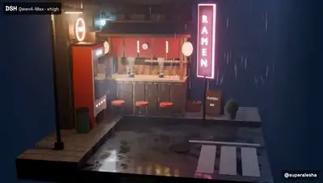</a><br><a href="https://www.sandbase.ai/lab/ai-videos/qwen4-max/2120666965060559213?lang=zh-CN&utm_source=github&utm_medium=readme&utm_campaign=awesome-qwen4-max&utm_content=card"><b>Blender程序化拉面摊微缩场景</b></a><br><sub><a href="https://x.com/superalesha/status/2120666965060559213">@superalesha</a> · 0:37 · <a href="https://www.sandbase.ai/lab/ai-videos/qwen4-max/2120666965060559213?lang=zh-CN&utm_source=github&utm_medium=readme&utm_campaign=awesome-qwen4-max&utm_content=card">提示词</a></sub></td><td width="33%" valign="top"><a href="https://www.sandbase.ai/lab/media/x/qwen4-max/2120718224031715706/video.mp4">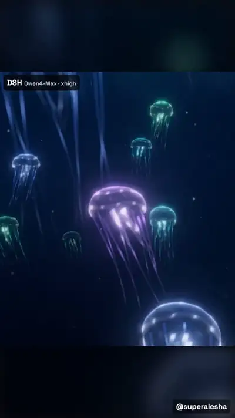</a><br><a href="https://www.sandbase.ai/lab/ai-videos/qwen4-max/2120718224031715706?lang=zh-CN&utm_source=github&utm_medium=readme&utm_campaign=awesome-qwen4-max&utm_content=card"><b>Three.js 深海发光水母群</b></a><br><sub><a href="https://x.com/superalesha/status/2120718224031715706">@superalesha</a> · 0:37 · <a href="https://www.sandbase.ai/lab/ai-videos/qwen4-max/2120718224031715706?lang=zh-CN&utm_source=github&utm_medium=readme&utm_campaign=awesome-qwen4-max&utm_content=card">提示词</a></sub></td></tr>
</table>

<details>
<summary><b>展开全部 12 条</b></summary>

<table>
<tr><td width="33%" valign="top"><a href="https://www.sandbase.ai/lab/media/x/qwen4-max/2121859996937818325/video.mp4">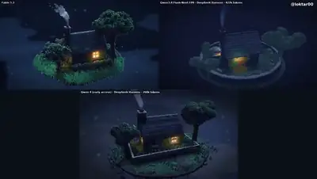</a><br><a href="https://www.sandbase.ai/lab/ai-videos/qwen4-max/2121859996937818325?lang=zh-CN&utm_source=github&utm_medium=readme&utm_campaign=awesome-qwen4-max&utm_content=card"><b>3D乡村小屋场景</b></a><br><sub><a href="https://x.com/loktar00/status/2121859996937818325">@loktar00</a> · 0:26</sub></td><td width="33%" valign="top"><a href="https://www.sandbase.ai/lab/media/x/qwen4-max/2121939161812697367/video.mp4">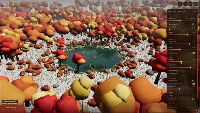</a><br><a href="https://www.sandbase.ai/lab/ai-videos/qwen4-max/2121939161812697367?lang=zh-CN&utm_source=github&utm_medium=readme&utm_campaign=awesome-qwen4-max&utm_content=card"><b>秋日森林中游动锦鲤的池塘</b></a><br><sub><a href="https://x.com/ItsmeAjayKV/status/2121939161812697367">@ItsmeAjayKV</a> · 1:38</sub></td><td width="33%" valign="top"><a href="https://www.sandbase.ai/lab/media/x/qwen4-max/2122179688319930761/video.mp4">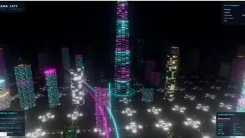</a><br><a href="https://www.sandbase.ai/lab/ai-videos/qwen4-max/2122179688319930761?lang=zh-CN&utm_source=github&utm_medium=readme&utm_campaign=awesome-qwen4-max&utm_content=card"><b>Three.js构建的赛博朋克城市</b></a><br><sub><a href="https://x.com/NFT_Chen/status/2122179688319930761">@NFT_Chen</a> · 1:07</sub></td></tr>
<tr><td width="33%" valign="top"><a href="https://www.sandbase.ai/lab/media/x/qwen4-max/2122198718829236635/video.mp4">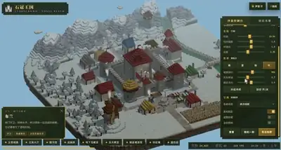</a><br><a href="https://www.sandbase.ai/lab/ai-videos/qwen4-max/2122198718829236635?lang=zh-CN&utm_source=github&utm_medium=readme&utm_campaign=awesome-qwen4-max&utm_content=card"><b>Three.js体素中世纪王国沙盘</b></a><br><sub><a href="https://x.com/dragono64v/status/2122198718829236635">@dragono64v</a> · 0:48</sub></td><td width="33%" valign="top"><a href="https://www.sandbase.ai/lab/media/x/qwen4-max/2122207033885933633/video.mp4">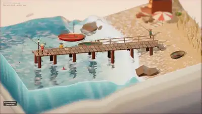</a><br><a href="https://www.sandbase.ai/lab/ai-videos/qwen4-max/2122207033885933633?lang=zh-CN&utm_source=github&utm_medium=readme&utm_campaign=awesome-qwen4-max&utm_content=card"><b>单次生成的3D虚拟世界场景</b></a><br><sub><a href="https://x.com/ItsmeAjayKV/status/2122207033885933633">@ItsmeAjayKV</a> · 0:47</sub></td><td width="33%" valign="top"><a href="https://www.sandbase.ai/lab/media/x/qwen4-max/2122264972889563391/video.mp4">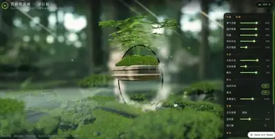</a><br><a href="https://www.sandbase.ai/lab/ai-videos/qwen4-max/2122264972889563391?lang=zh-CN&utm_source=github&utm_medium=readme&utm_campaign=awesome-qwen4-max&utm_content=card"><b>可3D交互的雾雨森林苔藓微景观浮石庭</b></a><br><sub><a href="https://x.com/tanglele0318/status/2122264972889563391">@tanglele0318</a> · 0:37</sub></td></tr>
</table>

</details>

<a id="motion-graphics"></a>

## 动效

<table>
<tr><td width="33%" valign="top"><a href="https://www.sandbase.ai/lab/media/x/qwen4-max/2120345166997324170/video.mp4"></a><br><a href="https://www.sandbase.ai/lab/ai-videos/qwen4-max/2120345166997324170?lang=zh-CN&utm_source=github&utm_medium=readme&utm_campaign=awesome-qwen4-max&utm_content=card"><b>鹈鹕骑自行车的 SVG 动画测试</b></a><br><sub><a href="https://x.com/leo114119/status/2120345166997324170">@leo114119</a> · 0:33</sub></td><td width="33%" valign="top"><a href="https://www.sandbase.ai/lab/media/x/qwen4-max/2120356035181654391/video.mp4">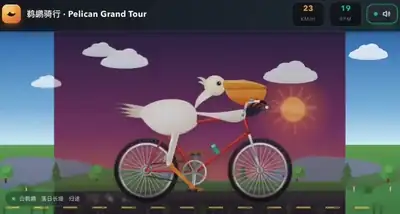</a><br><a href="https://www.sandbase.ai/lab/ai-videos/qwen4-max/2120356035181654391?lang=zh-CN&utm_source=github&utm_medium=readme&utm_campaign=awesome-qwen4-max&utm_content=card"><b>鹈鹕骑自行车的SVG动画</b></a><br><sub><a href="https://x.com/xiax0603/status/2120356035181654391">@xiax0603</a> · 0:33</sub></td><td width="33%" valign="top"><a href="https://www.sandbase.ai/lab/media/x/qwen4-max/2120386245658624446/video.mp4">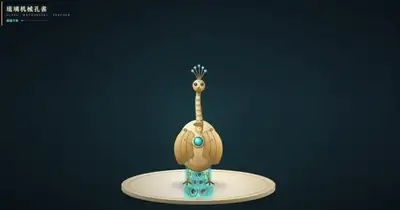</a><br><a href="https://www.sandbase.ai/lab/ai-videos/qwen4-max/2120386245658624446?lang=zh-CN&utm_source=github&utm_medium=readme&utm_campaign=awesome-qwen4-max&utm_content=card"><b>琉璃机械孔雀开屏SVG动画</b></a><br><sub><a href="https://x.com/leo114119/status/2120386245658624446">@leo114119</a> · 0:31</sub></td></tr>
<tr><td width="33%" valign="top"><a href="https://www.sandbase.ai/lab/media/x/qwen4-max/2120400676379365543/video.mp4"></a><br><a href="https://www.sandbase.ai/lab/ai-videos/qwen4-max/2120400676379365543?lang=zh-CN&utm_source=github&utm_medium=readme&utm_campaign=awesome-qwen4-max&utm_content=card"><b>鹈鹕骑车与仿生兽动态前端效果</b></a><br><sub><a href="https://x.com/LufzzLiz/status/2120400676379365543">@LufzzLiz</a> · 0:52</sub></td><td width="33%" valign="top"><a href="https://www.sandbase.ai/lab/media/x/qwen4-max/2121475034296520920/video.mp4">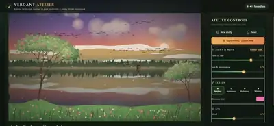</a><br><a href="https://www.sandbase.ai/lab/ai-videos/qwen4-max/2121475034296520920?lang=zh-CN&utm_source=github&utm_medium=readme&utm_campaign=awesome-qwen4-max&utm_content=card"><b>JavaScript绘制的美丽自然风景</b></a><br><sub><a href="https://x.com/badboy999654/status/2121475034296520920">@badboy999654</a> · 2:48 · <a href="https://www.sandbase.ai/lab/ai-videos/qwen4-max/2121475034296520920?lang=zh-CN&utm_source=github&utm_medium=readme&utm_campaign=awesome-qwen4-max&utm_content=card">提示词</a></sub></td><td width="33%" valign="top"><a href="https://www.sandbase.ai/lab/media/x/qwen4-max/2121532630009282782/video.mp4"></a><br><a href="https://www.sandbase.ai/lab/ai-videos/qwen4-max/2121532630009282782?lang=zh-CN&utm_source=github&utm_medium=readme&utm_campaign=awesome-qwen4-max&utm_content=card"><b>单次生成的PS4手柄SVG</b></a><br><sub><a href="https://x.com/badboy999654/status/2121532630009282782">@badboy999654</a> · 2:29</sub></td></tr>
</table>

<details>
<summary><b>展开全部 9 条</b></summary>

<table>
<tr><td width="33%" valign="top"><a href="https://www.sandbase.ai/lab/media/x/qwen4-max/2122153465925308590/video.mp4">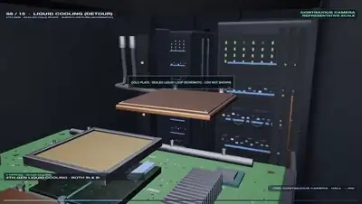</a><br><a href="https://www.sandbase.ai/lab/ai-videos/qwen4-max/2122153465925308590?lang=zh-CN&utm_source=github&utm_medium=readme&utm_campaign=awesome-qwen4-max&utm_content=card"><b>芯片基准测试循环迭代渲染展示</b></a><br><sub><a href="https://x.com/SPAC89/status/2122153465925308590">@SPAC89</a> · 0:25</sub></td><td width="33%" valign="top"><a href="https://www.sandbase.ai/lab/media/x/qwen4-max/2122165587497685266/video.mp4">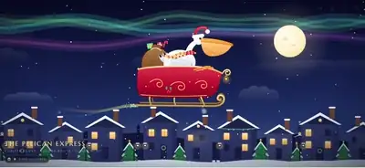</a><br><a href="https://www.sandbase.ai/lab/ai-videos/qwen4-max/2122165587497685266?lang=zh-CN&utm_source=github&utm_medium=readme&utm_campaign=awesome-qwen4-max&utm_content=card"><b>扮成圣诞老人的鹈鹕SVG动画</b></a><br><sub><a href="https://x.com/badboy999654/status/2122165587497685266">@badboy999654</a> · 1:04</sub></td><td width="33%" valign="top"><a href="https://www.sandbase.ai/lab/media/x/qwen4-max/2122169039061750020/video.mp4">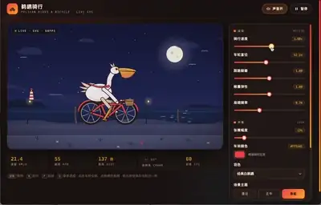</a><br><a href="https://www.sandbase.ai/lab/ai-videos/qwen4-max/2122169039061750020?lang=zh-CN&utm_source=github&utm_medium=readme&utm_campaign=awesome-qwen4-max&utm_content=card"><b>SVG鹈鹕骑自行车2D动画</b></a><br><sub><a href="https://x.com/Aurora0x3f/status/2122169039061750020">@Aurora0x3f</a> · 0:38 · <a href="https://www.sandbase.ai/lab/ai-videos/qwen4-max/2122169039061750020?lang=zh-CN&utm_source=github&utm_medium=readme&utm_campaign=awesome-qwen4-max&utm_content=card">提示词</a></sub></td></tr>
</table>

</details>

<a id="game"></a>

## 游戏

<table>
<tr><td width="33%" valign="top"><a href="https://www.sandbase.ai/lab/media/x/qwen4-max/2120492162148384834/video.mp4">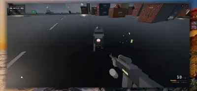</a><br><a href="https://www.sandbase.ai/lab/ai-videos/qwen4-max/2120492162148384834?lang=zh-CN&utm_source=github&utm_medium=readme&utm_campaign=awesome-qwen4-max&utm_content=card"><b>单HTML文件复刻热门游戏</b></a><br><sub><a href="https://x.com/LufzzLiz/status/2120492162148384834">@LufzzLiz</a> · 1:13</sub></td><td width="33%" valign="top"><a href="https://www.sandbase.ai/lab/media/x/qwen4-max/2122018725977010388/video.mp4"></a><br><a href="https://www.sandbase.ai/lab/ai-videos/qwen4-max/2122018725977010388?lang=zh-CN&utm_source=github&utm_medium=readme&utm_campaign=awesome-qwen4-max&utm_content=card"><b>采用高斯泼溅渲染的毁灭战士重构</b></a><br><sub><a href="https://x.com/DrTBehrens/status/2122018725977010388">@DrTBehrens</a> · 0:49</sub></td><td width="33%" valign="top"><a href="https://www.sandbase.ai/lab/media/x/qwen4-max/2122161410805321796/video.mp4">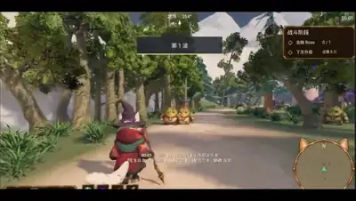</a><br><a href="https://www.sandbase.ai/lab/ai-videos/qwen4-max/2122161410805321796?lang=zh-CN&utm_source=github&utm_medium=readme&utm_campaign=awesome-qwen4-max&utm_content=card"><b>使用Unity构建的可玩游戏演示</b></a><br><sub><a href="https://x.com/intheworldofai/status/2122161410805321796">@intheworldofai</a> · 0:51</sub></td></tr>
</table>

<a id="ui-demo"></a>

## 产品界面

<table>
<tr><td width="33%" valign="top"><a href="https://www.sandbase.ai/lab/media/x/qwen4-max/2122164935761260584/video.mp4"></a><br><a href="https://www.sandbase.ai/lab/ai-videos/qwen4-max/2122164935761260584?lang=zh-CN&utm_source=github&utm_medium=readme&utm_campaign=awesome-qwen4-max&utm_content=card"><b>包含3D元素的可演奏小提琴网页应用</b></a><br><sub><a href="https://x.com/he1000se/status/2122164935761260584">@he1000se</a> · 0:28 · <a href="https://www.sandbase.ai/lab/ai-videos/qwen4-max/2122164935761260584?lang=zh-CN&utm_source=github&utm_medium=readme&utm_campaign=awesome-qwen4-max&utm_content=card">提示词</a></sub></td></tr>
</table>

<a id="kinetic-type"></a>

## 文字动效

<table>
<tr><td width="33%" valign="top"><a href="https://www.sandbase.ai/lab/media/x/qwen4-max/2120414419230605560/video.mp4"></a><br><a href="https://www.sandbase.ai/lab/ai-videos/qwen4-max/2120414419230605560?lang=zh-CN&utm_source=github&utm_medium=readme&utm_campaign=awesome-qwen4-max&utm_content=card"><b>一只骑自行车的鹈鹕的 动画SVG</b></a><br><sub><a href="https://x.com/xiangxiang103/status/2120414419230605560">@xiangxiang103</a> · 2:01 · <a href="https://www.sandbase.ai/lab/ai-videos/qwen4-max/2120414419230605560?lang=zh-CN&utm_source=github&utm_medium=readme&utm_campaign=awesome-qwen4-max&utm_content=card">提示词</a></sub></td></tr>
</table>

<a id="comparison"></a>

## 测试对比

<table>
<tr><td width="33%" valign="top"><a href="https://www.sandbase.ai/lab/media/x/qwen4-max/2120383891605434723/video.mp4">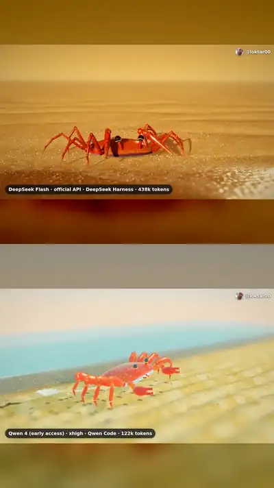</a><br><a href="https://www.sandbase.ai/lab/ai-videos/qwen4-max/2120383891605434723?lang=zh-CN&utm_source=github&utm_medium=readme&utm_campaign=awesome-qwen4-max&utm_content=card"><b>海滩上的螃蟹生成效果对比</b></a><br><sub><a href="https://x.com/loktar00/status/2120383891605434723">@loktar00</a> · 0:30</sub></td><td width="33%" valign="top"><a href="https://www.sandbase.ai/lab/media/x/qwen4-max/2120398335098118335/video.mp4">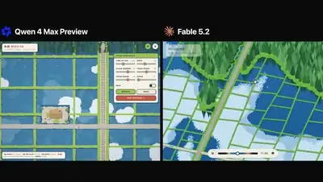</a><br><a href="https://www.sandbase.ai/lab/ai-videos/qwen4-max/2120398335098118335?lang=zh-CN&utm_source=github&utm_medium=readme&utm_campaign=awesome-qwen4-max&utm_content=card"><b>Fable与Qwen游戏生成效果对比</b></a><br><sub><a href="https://x.com/fawnunwrap/status/2120398335098118335">@fawnunwrap</a> · 0:36</sub></td><td width="33%" valign="top"><a href="https://www.sandbase.ai/lab/media/x/qwen4-max/2120446429718086142/video.mp4">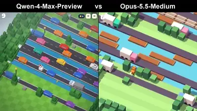</a><br><a href="https://www.sandbase.ai/lab/ai-videos/qwen4-max/2120446429718086142?lang=zh-CN&utm_source=github&utm_medium=readme&utm_campaign=awesome-qwen4-max&utm_content=card"><b>AI模型生成的天天过马路游戏对比</b></a><br><sub><a href="https://x.com/markksantos/status/2120446429718086142">@markksantos</a> · 0:40 · <a href="https://www.sandbase.ai/lab/ai-videos/qwen4-max/2120446429718086142?lang=zh-CN&utm_source=github&utm_medium=readme&utm_campaign=awesome-qwen4-max&utm_content=card">提示词</a></sub></td></tr>
<tr><td width="33%" valign="top"><a href="https://www.sandbase.ai/lab/media/x/qwen4-max/2120505982640120008/video.mp4">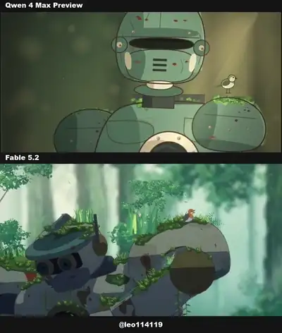</a><br><a href="https://www.sandbase.ai/lab/ai-videos/qwen4-max/2120505982640120008?lang=zh-CN&utm_source=github&utm_medium=readme&utm_campaign=awesome-qwen4-max&utm_content=card"><b>长满苔藓的机器人故事短片对比</b></a><br><sub><a href="https://x.com/AnikaCodes/status/2120505982640120008">@AnikaCodes</a> · 1:02</sub></td><td width="33%" valign="top"><a href="https://www.sandbase.ai/lab/media/x/minimax-m3-1-flash/2120544045797937387/video.mp4">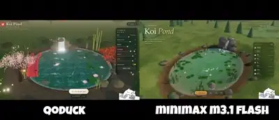</a><br><a href="https://www.sandbase.ai/lab/ai-videos/qwen4-max/2120544045797937387?lang=zh-CN&utm_source=github&utm_medium=readme&utm_campaign=awesome-qwen4-max&utm_content=card"><b>两款大模型同提示词生成对比</b></a><br><sub><a href="https://x.com/notjazii/status/2120544045797937387">@notjazii</a> · 0:33</sub></td><td width="33%" valign="top"><a href="https://www.sandbase.ai/lab/media/x/qwen4-max/2120557983365271979/video.mp4">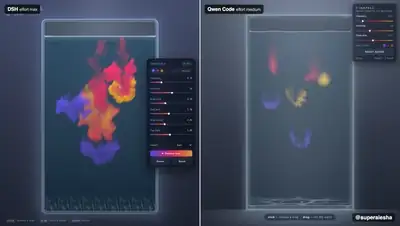</a><br><a href="https://www.sandbase.ai/lab/ai-videos/qwen4-max/2120557983365271979?lang=zh-CN&utm_source=github&utm_medium=readme&utm_campaign=awesome-qwen4-max&utm_content=card"><b>墨水入水模拟效果对比</b></a><br><sub><a href="https://x.com/superalesha/status/2120557983365271979">@superalesha</a> · 0:22</sub></td></tr>
</table>

<details>
<summary><b>展开全部 20 条</b></summary>

<table>
<tr><td width="33%" valign="top"><a href="https://www.sandbase.ai/lab/media/x/qwen4-max/2120631382099763414/video.mp4">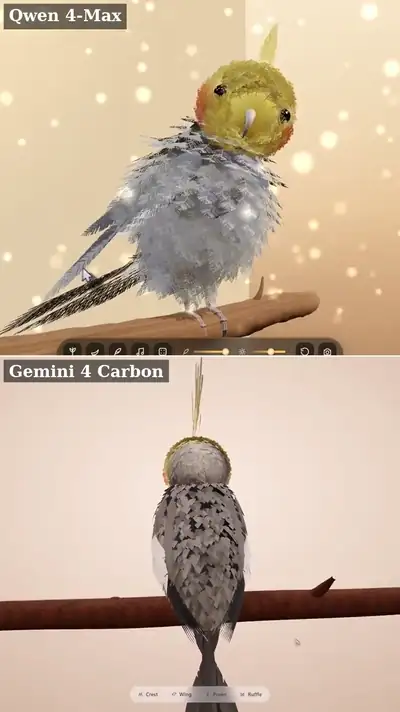</a><br><a href="https://www.sandbase.ai/lab/ai-videos/qwen4-max/2120631382099763414?lang=zh-CN&utm_source=github&utm_medium=readme&utm_campaign=awesome-qwen4-max&utm_content=card"><b>Qwen 4 Max与Gemini 4对比</b></a><br><sub><a href="https://x.com/DrstaOne/status/2120631382099763414">@DrstaOne</a> · 0:43</sub></td><td width="33%" valign="top"><a href="https://www.sandbase.ai/lab/media/x/qwen4-max/2120697659941847244/video.mp4">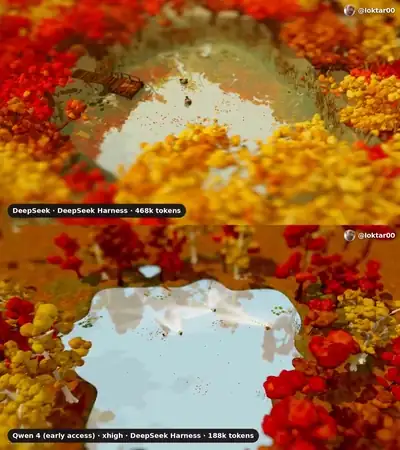</a><br><a href="https://www.sandbase.ai/lab/ai-videos/qwen4-max/2120697659941847244?lang=zh-CN&utm_source=github&utm_medium=readme&utm_campaign=awesome-qwen4-max&utm_content=card"><b>DeepSeek与Qwen同提示词生成对比</b></a><br><sub><a href="https://x.com/loktar00/status/2120697659941847244">@loktar00</a> · 0:30</sub></td><td width="33%" valign="top"><a href="https://www.sandbase.ai/lab/media/x/gemini-4-carbon/2120846360064692377/video.mp4">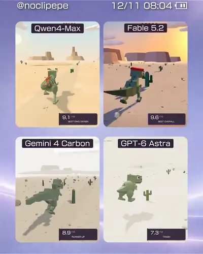</a><br><a href="https://www.sandbase.ai/lab/ai-videos/qwen4-max/2120846360064692377?lang=zh-CN&utm_source=github&utm_medium=readme&utm_campaign=awesome-qwen4-max&utm_content=card"><b>Chrome恐龙游戏复刻模型对比</b></a><br><sub><a href="https://x.com/noclipepe/status/2120846360064692377">@noclipepe</a> · 0:28</sub></td></tr>
<tr><td width="33%" valign="top"><a href="https://www.sandbase.ai/lab/media/x/qwen4-max/2120949029647581552/video.mp4">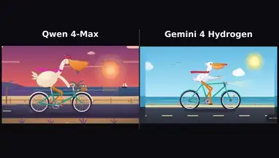</a><br><a href="https://www.sandbase.ai/lab/ai-videos/qwen4-max/2120949029647581552?lang=zh-CN&utm_source=github&utm_medium=readme&utm_campaign=awesome-qwen4-max&utm_content=card"><b>同提示词下不同模型的输出对比</b></a><br><sub><a href="https://x.com/DrstaOne/status/2120949029647581552">@DrstaOne</a> · 0:31</sub></td><td width="33%" valign="top"><a href="https://www.sandbase.ai/lab/media/x/qwen4-max/2121130120530567601/video.mp4">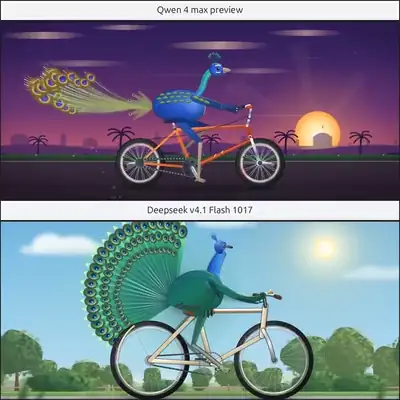</a><br><a href="https://www.sandbase.ai/lab/ai-videos/qwen4-max/2121130120530567601?lang=zh-CN&utm_source=github&utm_medium=readme&utm_campaign=awesome-qwen4-max&utm_content=card"><b>孔雀骑自行车 SVG 动画效果对比</b></a><br><sub><a href="https://x.com/SahilPanhotra/status/2121130120530567601">@SahilPanhotra</a> · 0:10</sub></td><td width="33%" valign="top"><a href="https://www.sandbase.ai/lab/media/x/gemini-4-hydrogen/2121219775170761044/video.mp4">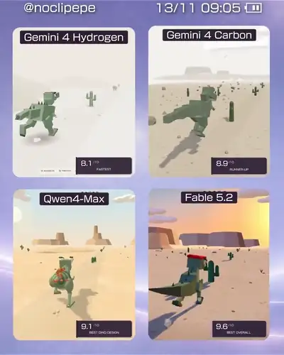</a><br><a href="https://www.sandbase.ai/lab/ai-videos/qwen4-max/2121219775170761044?lang=zh-CN&utm_source=github&utm_medium=readme&utm_campaign=awesome-qwen4-max&utm_content=card"><b>Chrome恐龙小游戏多模型生成速度对比</b></a><br><sub><a href="https://x.com/noclipepe/status/2121219775170761044">@noclipepe</a> · 0:28</sub></td></tr>
<tr><td width="33%" valign="top"><a href="https://www.sandbase.ai/lab/media/x/gemini-4-hydrogen/2121305690585383385/video.mp4">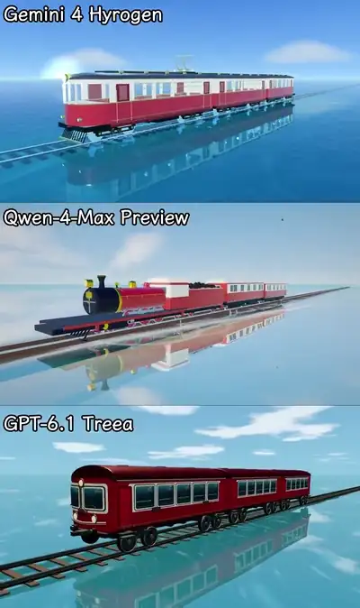</a><br><a href="https://www.sandbase.ai/lab/ai-videos/qwen4-max/2121305690585383385?lang=zh-CN&utm_source=github&utm_medium=readme&utm_campaign=awesome-qwen4-max&utm_content=card"><b>三款大模型生成速度横向对比</b></a><br><sub><a href="https://x.com/AnikaCodes/status/2121305690585383385">@AnikaCodes</a> · 0:20</sub></td><td width="33%" valign="top"><a href="https://www.sandbase.ai/lab/media/x/qwen4-max/2121774514698662123/video.mp4">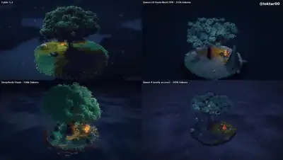</a><br><a href="https://www.sandbase.ai/lab/ai-videos/qwen4-max/2121774514698662123?lang=zh-CN&utm_source=github&utm_medium=readme&utm_campaign=awesome-qwen4-max&utm_content=card"><b>高斯溅射夜间橡树场景对比</b></a><br><sub><a href="https://x.com/loktar00/status/2121774514698662123">@loktar00</a> · 0:36</sub></td><td width="33%" valign="top"><a href="https://www.sandbase.ai/lab/media/x/qwen4-max/2121947540509831302/video.mp4">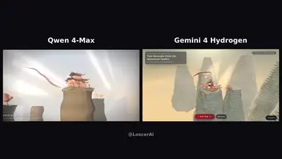</a><br><a href="https://www.sandbase.ai/lab/ai-videos/qwen4-max/2121947540509831302?lang=zh-CN&utm_source=github&utm_medium=readme&utm_campaign=awesome-qwen4-max&utm_content=card"><b>双龙在山间古寺上方激战</b></a><br><sub><a href="https://x.com/DrstaOne/status/2121947540509831302">@DrstaOne</a> · 0:32</sub></td></tr>
<tr><td width="33%" valign="top"><a href="https://www.sandbase.ai/lab/media/x/qwen4-max/2122182167799451659/video.mp4">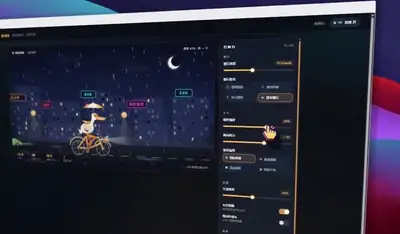</a><br><a href="https://www.sandbase.ai/lab/ai-videos/qwen4-max/2122182167799451659?lang=zh-CN&utm_source=github&utm_medium=readme&utm_campaign=awesome-qwen4-max&utm_content=card"><b>三款模型制作雨中鹈鹕骑车对比</b></a><br><sub><a href="https://x.com/hiwise_aigc/status/2122182167799451659">@hiwise_aigc</a> · 0:37</sub></td><td width="33%" valign="top"><a href="https://www.sandbase.ai/lab/media/x/qwen4-max/2122213962011881801/video.mp4">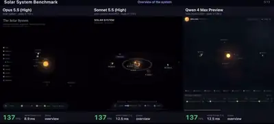</a><br><a href="https://www.sandbase.ai/lab/ai-videos/qwen4-max/2122213962011881801?lang=zh-CN&utm_source=github&utm_medium=readme&utm_campaign=awesome-qwen4-max&utm_content=card"><b>原生WebGL交互式3D太阳系代码对比</b></a><br><sub><a href="https://x.com/Frtnel/status/2122213962011881801">@Frtnel</a> · 1:08 · <a href="https://www.sandbase.ai/lab/ai-videos/qwen4-max/2122213962011881801?lang=zh-CN&utm_source=github&utm_medium=readme&utm_campaign=awesome-qwen4-max&utm_content=card">提示词</a></sub></td><td width="33%" valign="top"><a href="https://www.sandbase.ai/lab/media/x/qwen4-max/2122221106304352257/video.mp4">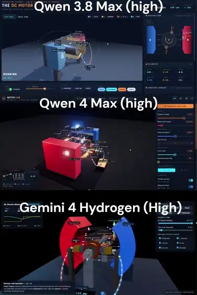</a><br><a href="https://www.sandbase.ai/lab/ai-videos/qwen4-max/2122221106304352257?lang=zh-CN&utm_source=github&utm_medium=readme&utm_campaign=awesome-qwen4-max&utm_content=card"><b>电动马达动画与物理模拟对比</b></a><br><sub><a href="https://x.com/analogalok/status/2122221106304352257">@analogalok</a> · 0:13 · <a href="https://www.sandbase.ai/lab/ai-videos/qwen4-max/2122221106304352257?lang=zh-CN&utm_source=github&utm_medium=readme&utm_campaign=awesome-qwen4-max&utm_content=card">提示词</a></sub></td></tr>
<tr><td width="33%" valign="top"><a href="https://www.sandbase.ai/lab/media/x/qwen4-max/2122275275132072029/video.mp4"></a><br><a href="https://www.sandbase.ai/lab/ai-videos/qwen4-max/2122275275132072029?lang=zh-CN&utm_source=github&utm_medium=readme&utm_campaign=awesome-qwen4-max&utm_content=card"><b>Qwen 4 Max与Claude Opus 5.5骑车鹈鹕对比</b></a><br><sub><a href="https://x.com/atomic_chat_hq/status/2122275275132072029">@atomic_chat_hq</a> · 0:07 · <a href="https://www.sandbase.ai/lab/ai-videos/qwen4-max/2122275275132072029?lang=zh-CN&utm_source=github&utm_medium=readme&utm_campaign=awesome-qwen4-max&utm_content=card">提示词</a></sub></td><td width="33%" valign="top"><a href="https://www.sandbase.ai/lab/media/x/qwen4-max/2122278047403348332/video.mp4">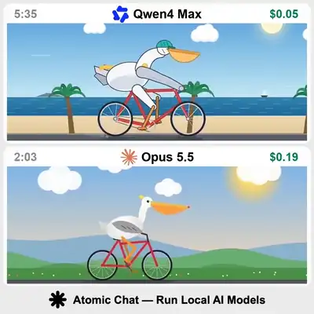</a><br><a href="https://www.sandbase.ai/lab/ai-videos/qwen4-max/2122278047403348332?lang=zh-CN&utm_source=github&utm_medium=readme&utm_campaign=awesome-qwen4-max&utm_content=card"><b>Qwen 4 Max与Claude Opus 5.5骑车鹈鹕对比</b></a><br><sub><a href="https://x.com/atomic_chat_hq/status/2122278047403348332">@atomic_chat_hq</a> · 0:07 · <a href="https://www.sandbase.ai/lab/ai-videos/qwen4-max/2122278047403348332?lang=zh-CN&utm_source=github&utm_medium=readme&utm_campaign=awesome-qwen4-max&utm_content=card">提示词</a></sub></td></tr>
</table>

</details>

**[在 SandBase Lab 查看全部 46 条 →](https://www.sandbase.ai/lab/ai-videos/qwen4-max?lang=zh-CN&utm_source=github&utm_medium=readme&utm_campaign=awesome-qwen4-max&utm_content=section)**

<a id="recreate"></a>

## 用 Qwen 4 Max 复刻视频

[SandBase Lab](https://www.sandbase.ai/lab/ai-videos/qwen4-max?lang=zh-CN&utm_source=github&utm_medium=readme&utm_campaign=awesome-qwen4-max&utm_content=recreate) 的每个视频页都有 **复刻** 按钮：在 Lab 文本竞技场把帖子内容发给 Qwen 4 Max，返回可在浏览器直接播放的代码。

用 API 的话，Qwen 4 Max 在 SandBase 上的模型 ID 是 `alibaba/qwen4-max`（兼容 OpenAI）。把提示词写进 `prompt.txt`，在 [控制台](https://www.sandbase.ai/console/keys?utm_source=github&utm_medium=readme&utm_campaign=awesome-qwen4-max) 创建 Key，然后运行：

```bash
jq -n --rawfile prompt prompt.txt \
  '{model: "alibaba/qwen4-max", max_tokens: 128000, messages: [{role: "user", content: $prompt}]}' |
curl -sS --max-time 900 https://api.sandbase.ai/v1/chat/completions \
  -H "Authorization: Bearer $SANDBASE_API_KEY" \
  -H "Content-Type: application/json" \
  -d @- | jq -r '.choices[0].message.content' | sed '/^```/d' > qwen4-max.html
```

用浏览器打开 `qwen4-max.html`，或在 [SandBase Sandbox](https://www.sandbase.ai/landing/sandbox?utm_source=github&utm_medium=readme&utm_campaign=awesome-qwen4-max) 中运行，让生成的代码保持隔离。上面的示例给到 128,000 `max_tokens`，因为作者的运行分别报告了 17.2 万和 19.7 万 token；长页面请再加大。完整步骤见 [教程](docs/zh-CN/tutorial.md)，价格见 [模型页](https://www.sandbase.ai/model/alibaba/qwen4-max?utm_source=github&utm_medium=readme&utm_campaign=awesome-qwen4-max)。

<a id="faq"></a>

## 常见问题

### Qwen 4 Max 是什么？

Qwen4-Max 是阿里巴巴的 Qwen 4 Max 模型。Lab 合集于 2026 年 11 月 11 日公布，这里的创作者测试的是预览版；@xiangxiang103 称它在 Qoder 上以预览形式首发，并表示官方没有公布参数量和跑分。SandBase 标注的上下文窗口为 100 万 token。在 SandBase 上它是 `alibaba/qwen4-max`。来源：`sandbase inspect alibaba/qwen4-max`。

### 这些 Qwen 4 Max 视频是怎么做出来的？

模型并不直接渲染视频。它写出代码，通常是一个 HTML 页面（Three.js、WebGL、Canvas 或 SVG），作者再把页面播放过程录下来。有作者通过 OpenCode、Qwen Code 等编码 harness 运行，也有人通过 MCP 连接让它驱动 Blender。见 [教程](docs/zh-CN/tutorial.md)。

### 在哪里找到视频的提示词？

标有 **提示词** 的视频，其 Lab 页面上有作者的提示词。[提示词索引](docs/zh-CN/prompts.md) 列出了全部。

### 怎么写好 Qwen 4 Max 提示词？

指定输出一个独立的 HTML 文件，并说明用哪个渲染方式（Three.js、WebGL、Canvas 或 SVG）；写明约束，要求一次生成、不做修正；并说明用的是哪个 harness 和推理强度。详细写法和模板见 [提示词写法](docs/zh-CN/prompt-guide.md)。

### 怎么调用 Qwen 4 Max API？

在 SandBase 上模型 ID 是 `alibaba/qwen4-max`，使用兼容 OpenAI 的 `/v1/chat/completions` 接口，一个 Key 调用所有模型。见 [复刻](#recreate) 和 [模型页](https://www.sandbase.ai/model/alibaba/qwen4-max?utm_source=github&utm_medium=readme&utm_campaign=awesome-qwen4-max)。

### Qwen 4 Max 比 Claude Opus 5.5、Claude Sonnet 5.5 或 Gemini 4 Hydrogen 更强吗？

作者们的结论不一致。@analogalok 在一个电动机测试里发现 Gemini 4 Hydrogen 在 3D 写实度和清晰度上整体最好；@markksantos 说 Opus 赢了一个 Crossy Road 版本，"但真的很接近"；@Frtnel 报告 Opus 5.5 认为它的 WebGL 太阳系代码质量与 Sonnet 5.5 接近。创建本列表时，Lab [Evals 榜单](https://www.sandbase.ai/leaderboards?lang=zh-CN&utm_source=github&utm_medium=readme&utm_campaign=awesome-qwen4-max) 和 [Pelican Test](https://www.sandbase.ai/arena/pelican-test?lang=zh-CN&utm_source=github&utm_medium=readme&utm_campaign=awesome-qwen4-max) 都还没有 Qwen 4 Max 的数据行。详见 [模型对比](docs/zh-CN/model-comparison.md)。

### 做一个视频要花多少钱？

SandBase 标价为每百万输入 token $1.666667、每百万输出 token $5，缓存命中的输入按输入价的 5% 计费。本合集的作者公布的是 token 数量而非美元总额，所以请把 `usage` 字段按这些单价折算。来源：`sandbase inspect alibaba/qwen4-max` 和模型页。

### 可以转用这些视频吗？

默认不可以，视频归作者所有。见 [MEDIA-RIGHTS](MEDIA-RIGHTS.md)。

<a id="contribute"></a>

## 推荐作品

发现了应该收录的 Qwen 4 Max 作品？附上 X 原帖 [提交给我们](https://github.com/sandbase-lab/awesome-qwen4-max/issues/new?template=submit-video.yml)。通过后会先加入 SandBase Lab，下一次每日同步时出现在这里。觉得有用的话，点个 ⭐ 能让更多人看到。

## 致谢与权利

所有视频、提示词和帖子归作者所有。每张卡片都注明作者并链接原帖。MIT 许可证只覆盖本仓库的脚本。更正署名或下架视频请见 [MEDIA-RIGHTS](MEDIA-RIGHTS.md)。

与 Qwen（阿里巴巴）无隶属或背书关系。

---

由 [SandBase Lab](https://www.sandbase.ai/lab/?lang=zh-CN&utm_source=github&utm_medium=readme&utm_campaign=awesome-qwen4-max) 维护 · [全部 AI 视频合集](https://www.sandbase.ai/lab/ai-videos?lang=zh-CN&utm_source=github&utm_medium=readme&utm_campaign=awesome-qwen4-max)
